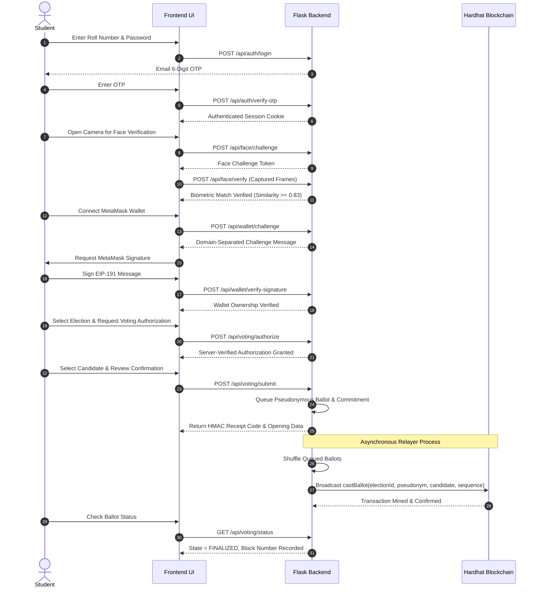
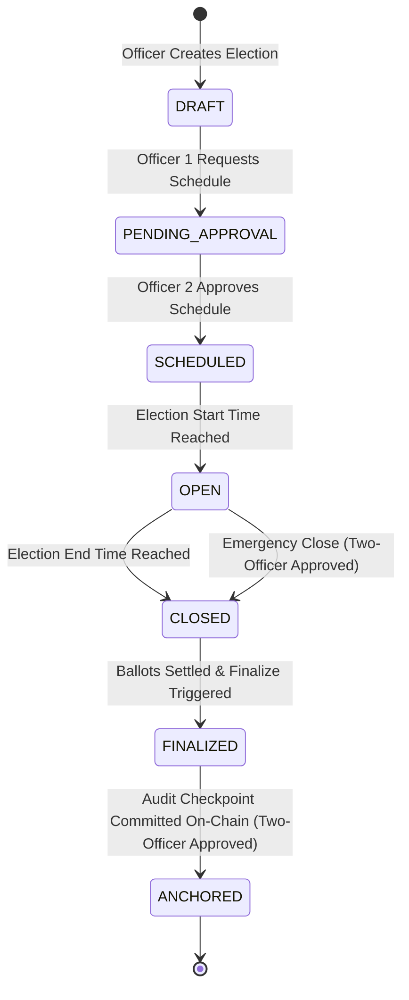
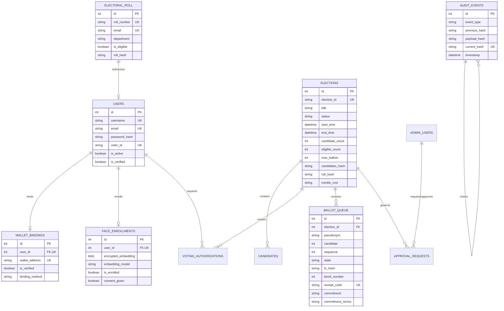

# PROJECT DOCUMENTATION: VOTE WITHOUT DOUBT

**AI & Blockchain-Based Secure E-Voting System for College Elections**

---

## 1. Project Title
**Vote Without Doubt: An AI-Assisted, Multi-Factor, Blockchain-Anchored E-Voting System for Collegiate Student Elections**

---

## 2. Abstract
Collegiate student government elections require high integrity, non-repudiation, and auditability while strictly protecting student privacy and vote secrecy. Traditional paper ballots and centralized digital voting portals suffer from vulnerabilities including single points of administrative compromise, coercion, undetected ballot stuffing, and lack of verifiable vote inclusion.

**Vote Without Doubt** presents a multi-tier, defense-in-depth electronic voting system that integrates multi-factor cryptographic authentication, biometric face matching, and blockchain ledger settlement. The student authentication pipeline requires three independent factors: password-based credentials with email-delivered time-based one-time passwords (OTP), 512-dimensional ArcFace biometric face embedding matching, and cryptographic wallet possession proofs signed via MetaMask (EIP-191).

To guarantee strict vote secrecy and prevent correlation between student identity and political choice, the architecture enforces dual-plane separation: the **Identity Plane** (authentication and eligibility) and the **Ballot Plane** (pseudonymous votes and on-chain ledger). Pseudonyms are derived deterministically using an isolated per-election cryptographic key that is permanently destroyed upon election finalization to guarantee forward secrecy. Ballots are submitted through an asynchronous backend relayer that cryptographically shuffles submissions before broadcasting transactions to an Ethereum smart contract deployed on a local Hardhat test network.

For verifiable auditability, accepted ballots generate high-entropy cryptographic commitments assembled into a deterministic binary Merkle tree following RFC 6962 specifications. Rather than claiming direct on-chain leaf storage, the architecture employs **audit-chain-mediated Merkle-root anchoring**, where finalized Merkle roots are bound to an immutable SHA-256 administrative audit hash chain and committed on-chain via a two-officer approval threshold protocol. Voters receive lightweight HMAC receipts allowing mathematical verification of ballot inclusion without leaking candidate choices, voter identities, or opening nonces.

---

## 3. Introduction
Student government elections represent a vital component of collegiate civic life. However, existing voting procedures in university environments face persistent challenges. Paper-based voting is resource-intensive, vulnerable to manual ballot-box tampering, and slow in tabulation. Commercial web-based voting portals frequently operate as opaque black boxes where students must blindly trust central database administrators and IT operators.

Vote Without Doubt addresses these deficiencies by eliminating blind trust. The design principle is encapsulated in its name: *Vote Without Doubt* requires that every operational claim—eligibility, authentication, ballot recording, and inclusion—is cryptographically verifiable by students, election officers, and independent auditors.

The system utilizes Ethereum smart contracts to enforce immutable election parameters (start and end times, candidate counts, eligible voter caps, and tally aggregation) while delegating cryptographic identity isolation to an off-chain application server. Through this split architecture, the platform reconciles public verifiability on a blockchain with the confidentiality mandates of institutional student privacy regulations.

---

## 4. Problem Statement
Electronic voting systems in academic institutions must satisfy fundamentally conflicting requirements:
1. **Strict Vote Secrecy vs. Absolute Verifiability**: The system must ensure that no party—including database administrators, election officers, or external observers—can link a voter's identity to their candidate choice. Concurrently, each voter must be able to independently verify that their ballot was recorded and tallied correctly.
2. **Eligibility Enforcement vs. Credential Sharing**: College elections are susceptible to credential stuffing, shared student portal logins, and coercive vote casting in dormitories. A simple username/password portal fails to verify physical voter presence or genuine consent.
3. **Administrative Tampering & Single-Point Compromise**: Centralized SQL databases allow privileged database administrators (DBAs) to modify tallies, inject counterfeit ballots, or alter audit logs directly in storage without detection.
4. **Coercion & Vote Buying**: If a receipt explicitly proves which candidate was selected, voters can be coerced or bribed into revealing their receipt to third parties.

---

## 5. Project Objectives
The engineering objectives of Vote Without Doubt are:
1. **Multi-Factor Verification**: Construct an identity verification pipeline combining institutional email OTP, ArcFace biometric face recognition, and Ethereum private key possession proofs.
2. **Cryptographic Identity/Ballot Separation**: Isolate voter identity records from ballot records using per-election deterministic pseudonyms and forward-secure key destruction.
3. **Decoupled Blockchain Settlement**: Implement a smart contract (`EVotingBallotBox.sol`) that records pseudonymous votes, enforces election windows and voter caps, and tallies selections without learning voter identities.
4. **Relayer Privacy Protection**: Build an asynchronous backend relayer that shuffles queued ballots, breaking temporal and order correlation between vote submission and blockchain mining.
5. **Privacy-Preserving Inclusion Verification**: Generate 256-bit high-entropy ballot commitments assembled into an RFC 6962 binary Merkle tree, enabling unauthenticated voters to independently verify inclusion without leaking their candidate choice or opening nonce.
6. **Audit-Chain-Mediated Blockchain Anchoring**: Bind election finalization events and Merkle roots to an unbroken SHA-256 audit hash chain, committing checkpoints on-chain through a mandatory two-officer (four-eyes principle) approval workflow.
7. **Transparent Public Verification**: Deliver a public, unauthenticated verification interface where observers can inspect on-chain contract state, candidate hashes, electoral roll hashes, audit trails, and inclusion proofs.

---

## 6. Scope of the Project
- **Target Environment**: Collegiate campus elections (student council, departmental representatives, club officers) with pre-enrolled student electoral rolls.
- **Client Interfaces**: Modern desktop and mobile web browsers supporting WebRTC camera video streams and MetaMask (or EIP-1193 Web3 provider extensions).
- **Backend & Network Boundary**: Flask Python backend communicating with a local SQLite/MySQL relational database and an Ethereum-compatible RPC node (demonstrated locally via Hardhat).
- **Out of Scope**: Inter-college federation, hardware biometric scanners, national-scale sovereign elections, and deployment to public Ethereum mainnets (due to gas fee structures and public peer-to-peer latency).

---

## 7. Existing System and Its Limitations

| Dimension | Physical Paper Ballots | Centralized Portal (e.g., Google Forms / Portal) | Commercial E-Voting Portals |
| :--- | :--- | :--- | :--- |
| **Authentication** | Physical student ID card check; vulnerable to fake IDs. | Single-factor college LDAP password. | Single-factor or SMS OTP. |
| **Tamper Resistance** | Dependent on physical box security and guard supervision. | None; DBA can update database records directly with SQL queries. | Dependent on proprietary vendor server security. |
| **Auditability** | Manual recount required; dispute-prone. | Opaque server logs; easily truncated or wiped. | Proprietary vendor audit certificates. |
| **Vote Secrecy** | High in voting booth; low during custody and sorting. | Low; database foreign keys link `user_id` to `choice`. | Variable; often stored in unified tables. |
| **Individual Verifiability** | Zero; voter leaves booth with no proof of inclusion. | Zero; voter receives confirmation email without cryptographic proof. | Partial; tracking code often links directly to candidate. |

---

## 8. Proposed System
Vote Without Doubt replaces trusted operators with mathematical and architectural guarantees:
- **Three-Factor Identity Gate**: A student must authenticate via Password + Email OTP, present their live face matching an enrolled biometric vector, and sign a domain-separated challenge using a private Ethereum key via MetaMask.
- **Server-Authoritative Authorization**: The server issues a short-lived, single-use `VotingAuthorization` token bound to the voter, election, and session. No factor can be spoofed or bypassed via client-side manipulation.
- **Pseudonymous Dual-Plane Partitioning**: The voter identity plane is stored in distinct database tables (`users`, `wallet_bindings`, `face_enrollments`), separated from the ballot queue (`ballot_queue`). The ballot queue stores only the pseudonymous hash $P = \text{HMAC}_{K_E}(\text{user\_id} \parallel \text{election\_id})$.
- **Relayer Shuffling**: Submissions are staged in an asynchronous queue. A backend worker shuffles the batch using cryptographically secure random permutation before broadcasting transactions, preventing network eavesdroppers from correlating submission timestamps with mined blocks.
- **Smart Contract Enforcement**: `EVotingBallotBox.sol` autonomously enforces election start/end timestamps, candidate index validity, maximum revote sequence limits, eligible voter capacity caps, and on-chain vote tabulation.
- **Merkle Inclusion Proofs**: All accepted ballots are assembled into an RFC 6962 binary Merkle tree. Voters verify ballot inclusion via logarithmic-depth cryptographic audit paths.
- **Two-Officer Audit Governance**: Administrative actions (scheduling, emergency closure, and blockchain audit anchoring) cannot be performed by a single administrator; they require a four-eyes protocol with distinct requester and approver officers.

---

## 9. Technology Stack

### Frontend Application
- **Framework**: React 18.2 with Vite 5.
- **Routing**: Single-page navigation via custom routing architecture.
- **Styling**: Vanilla CSS adhering to a curated **Neo-Brutalist** design system (high-contrast borders, bold typographic hierarchy, functional color coding, and responsive flex/grid layouts).
- **Biometric Capture**: HTML5 WebRTC `navigator.mediaDevices.getUserMedia` video streaming canvas processing.
- **Web3 Interface**: `ethers.js` (v6) interfacing with window.ethereum (EIP-1193 / MetaMask).

### Backend Application
- **Language & Framework**: Python 3.10+ with Flask.
- **Database ORM**: SQLAlchemy with Flask-SQLAlchemy and Alembic/Flask-Migrate.
- **Relational Databases**: SQLite 3 (local development and isolated testing); PyMySQL compatibility for production MySQL.
- **Cryptographic Libraries**: `cryptography` (Fernet, AES-CBC, HMAC), `hashlib`, `argon2-cffi` (password hashing), `ecdsa`, `eth_account`, `pycryptodome`.
- **Machine Learning & Biometrics**: InsightFace (ArcFace `buffalo_l` backbone producing 512-dimensional vector embeddings), OpenCV (`cv2`), ONNX Runtime.

### Blockchain & Smart Contracts
- **Contract Language**: Solidity `^0.8.19`.
- **Development & Node Environment**: Hardhat Local Node (`http://127.0.0.1:8545`, Chain ID 1337 / 31337).
- **Web3 Integration**: `web3.py` (v6) on backend; `ethers.js` on frontend.

---

## 10. System Architecture

```mermaid
graph TB
    subgraph Client Tier
        UI[React 18 Neo-Brutalist Frontend]
        MM[MetaMask Wallet Extension]
        CAM[WebRTC Camera Stream]
    end

    subgraph Backend API Tier (Identity Plane)
        AUTH[Auth & Session Service]
        FACE[ArcFace Biometric Engine]
        PAD[Shadow PAD Engine]
        OTP[Email OTP Service]
        WALLET[Wallet Signature Verifier]
        VA[Voting Authorization Gate]
    end

    subgraph Backend Settlement Tier (Ballot Plane)
        VOTE_SVC[Voting Service]
        QUEUE[(Ballot Queue Table)]
        RELAYER[Cryptographic Shuffling Relayer]
        MERKLE[RFC 6962 Merkle Engine]
        AUDIT[Audit Hash Chain Logger]
        GOV[Two-Officer Governance Engine]
    end

    subgraph Blockchain Tier
        RPC[Local Hardhat Node RPC]
        CONTRACT[EVotingBallotBox.sol Smart Contract]
    end

    UI -->|Password + OTP| AUTH
    CAM -->|Base64 Video Frames| FACE
    FACE -.->|Shadow Telemetry| PAD
    MM -->|EIP-191 Signature| WALLET
    AUTH & FACE & WALLET --> VA
    VA -->|Authorized Single-Use Token| VOTE_SVC
    VOTE_SVC -->|Pseudonymous Ballot & Commitment| QUEUE
    QUEUE --> RELAYER
    RELAYER -->|Shuffled castBallot Tx| RPC
    RPC --> CONTRACT
    VOTE_SVC --> MERKLE
    MERKLE --> AUDIT
    GOV -->|Two-Officer anchorAudit Tx| CONTRACT
```

The system is partitioned into two cryptographically isolated planes:
1. **The Identity Plane**: Operates in the client and API tiers. Processes student roll numbers, passwords, OTP tokens, facial biometrics, and wallet addresses. Produces a verified, single-use `VotingAuthorization` record.
2. **The Ballot Plane**: Operates on the settlement and blockchain tiers. Handles pseudonyms, candidate indices, commitments, relayer transaction execution, Merkle trees, and on-chain contract tallies. No voter identity fields cross the boundary into the ballot plane.

---

## 11. System Modules
1. **Electoral Roll & Student Registration Module**: Manages student eligibility by ingesting authoritative university roll datasets (`roll_number`, `email`, `department`). Enforces invitation-based registration.
2. **Multi-Factor Authentication Module**: Enforces Argon2id password hashing, SHA-256 HMAC-peppered email OTP generation with rate limits, and server-managed session tokens.
3. **Biometric Face Verification Module**: Extracts 512-dimensional facial embeddings using ArcFace, computes cosine similarity against enrolled templates, and logs presentation attack telemetry.
4. **MetaMask Wallet Binding Module**: Issues cryptographically random challenge nonces bound to user ID, session ID, and chain ID, verified via ECDSA `ecrecover`.
5. **Ballot Processing & Pseudonymization Module**: Derives pseudonyms deterministically using isolated per-election keys, verifies revote limits and cooldown periods, and computes ballot commitments.
6. **Blockchain Relayer Module**: Periodically polls queued ballots, shuffles batches to eliminate timing correlation, signs transactions with an authorized relayer account, and updates database records upon confirmation.
7. **Smart Contract (`EVotingBallotBox.sol`)**: Maintains on-chain election records, records pseudonymous votes, tracks candidate tallies, verifies sequence order, and stores audit checkpoints.
8. **Merkle Inclusion Proof Engine**: Implements RFC 6962 binary tree construction over ballot commitments, outputs logarithmic-depth audit paths, and verifies inclusion.
9. **Two-Officer Governance & Audit Module**: Maintains a linear SHA-256 audit hash chain, enforces four-eyes approval for critical lifecycle changes, and anchors checkpoints on-chain.
10. **Public Verification Module**: Provides unauthenticated endpoints for verifying candidate hashes, roll hashes, blockchain sync status, audit logs, and receipt proofs.

---

## 12. Student Workflow



---

## 13. Admin and Election Officer Workflow



### Administrative Role Separation
- **ELECTION_OFFICER**: Authorized to configure elections, upload electoral rolls, request approvals, approve requests initiated by *other* officers, and execute blockchain provisioning.
- **AUDITOR**: Read-only administrative access. Authorized to inspect audit chains, view reconciliation issues, export logs, and verify blockchain anchors. Strictly barred from requesting or approving state changes.

---

## 14. Registration and Authentication

### Electoral Roll Verification
Student registration is gated by a pre-loaded electoral roll table (`electoral_rolls`). The roll record contains the student's institutional USN/roll number, official email, department, eligibility status, and an enrollment hash:
$$\text{roll\_hash} = \text{SHA256}(\text{roll\_number} \parallel \text{email} \parallel \text{department})$$

Registration attempts with roll numbers not present in the electoral roll or marked `is_eligible = False` fail immediately with HTTP 403.

### Password Security
Passwords submitted during registration are validated against institutional complexity rules (minimum 10 characters, requiring uppercase, lowercase, numbers, and special symbols). Passwords are hashed using **Argon2id** via `argon2-cffi`:
- Time cost: 2 iterations
- Memory cost: 65,536 KB (64 MB)
- Parallelism: 4 threads
- Salt: 16 cryptographically secure random bytes

### Session Management
Successful authentication issues an HTTP-only, secure, SameSite=Strict cookie containing a 256-bit cryptographically random session identifier. Session records stored in the database track client IP address, User-Agent, creation time, expiration time, and revocation state.

---

## 15. Face Verification and Presentation Attack Detection

### Face Enrollment
During initial registration, the student submits a baseline frontal portrait captured via WebRTC.
1. The backend validates image format, resolution, and decodes the image via OpenCV.
2. The InsightFace ArcFace engine detects face landmarks using a RetinaFace detector.
3. If no face or multiple faces are detected, enrollment is rejected.
4. The deep convolutional network computes a 512-dimensional floating-point embedding vector:
   $$\mathbf{v} \in \mathbb{R}^{512}, \quad \|\mathbf{v}\|_2 = 1$$
5. The raw vector is serialized, encrypted at rest using Fernet symmetric encryption (`FACE_ENCRYPTION_KEY`), and written to `face_enrollments`. Raw images are discarded immediately from memory and never written to disk.

### Live Face Verification (Voting Gate)
When initiating voting authorization, the student requests a challenge (`POST /api/face/challenge`). The backend generates a random challenge ID valid for 20 seconds. The student's browser streams 1–5 video frames. The backend extracts embeddings $\mathbf{u}_i$ from the admitted frames and computes the cosine similarity against the stored enrollment vector $\mathbf{v}$:
$$\text{Similarity}(\mathbf{u}, \mathbf{v}) = \frac{\mathbf{u} \cdot \mathbf{v}}{\|\mathbf{u}\|_2 \|\mathbf{v}\|_2} = \sum_{k=1}^{512} u_k \cdot v_k$$
Verification succeeds if and only if $\text{Similarity} \ge 0.83$ (calibrated acceptance threshold).

### Presentation Attack Detection (PAD) Implementation Truth
- **Active Mode**: The active backend configuration enforces `FACE_PAD_MODE = 'shadow'`.
- **Operational Reality**: While an anti-spoofing feature extraction pipeline exists in the codebase (analyzing texture patterns, frequency domain artifacts, and color consistency), it operates strictly in **shadow telemetry mode**. It logs potential spoof scores for analytical purposes but **does not reject or fail voting attempts**.
- **Important Disclosure**: The system does **not** claim production-grade presentation attack resistance against high-quality photos, digital screens, silicone masks, or deepfake injections. Physical security and environmental supervision remain necessary for high-stakes deployment.

---

## 16. OTP Verification
To verify ownership of the student's institutional email address:
1. Upon submitting valid password credentials, the backend generates a 6-digit numeric OTP using `secrets.randbelow(1000000)`.
2. The OTP is hashed with a server-side pepper secret (`OTP_PEPPER`) using SHA-256 before database storage:
   $$\text{stored\_hash} = \text{SHA256}(\text{otp} \parallel \text{OTP\_PEPPER})$$
3. An email is dispatched via SMTP (configured in development for Gmail SMTP with TLS).
4. **Security Controls**:
   - Time-to-Live: Exactly 300 seconds (5 minutes).
   - Attempt Budget: Maximum 3 attempts per challenge; upon the 3rd failed attempt, the OTP is invalidated.
   - Resend Cooldown: 60 seconds minimum between dispatch requests.
   - Verification: Constant-time comparison (`hmac.compare_digest`) protects against timing side-channel attacks.

---

## 17. MetaMask Wallet Integration
Each student must bind a personal Ethereum wallet to establish non-repudiation of ballot authorization:
1. **Binding Challenge**: The frontend requests a challenge (`POST /api/wallet/challenge`). The backend returns a structured text message containing:
   - Institutional Domain: `votewithoutdoubt.local`
   - Bound Student User ID and Session ID
   - Blockchain Chain ID (1337 / Hardhat)
   - Cryptographic Nonce (32 bytes hex)
   - Issued Timestamp
2. **Signature Request**: The frontend invokes MetaMask via `ethereum.request({ method: 'personal_sign', params: [message, account] })`.
3. **Backend Recovery**: The backend formats the message per EIP-191 (`"\x19Ethereum Signed Message:\n" + len + message`), hashes it with Keccak-256, and recovers the public address using ECDSA recovery (`w3.eth.account.recover_message`).
4. **Verification**: If the recovered address matches the student's registered wallet binding, the wallet factor is marked verified in the database.

---

## 18. Blockchain Smart Contract Architecture

The core blockchain contract is `EVotingBallotBox.sol`, deployed on the local Hardhat node.

### State Variables & Mappings
- `address public officer`: The contract owner/deployer account authorized to provision elections and anchor audits.
- `address public relayer`: The authorized transaction broadcaster account.
- `mapping(uint256 => Election) public elections`: Stores structural parameters per election.
- `mapping(uint256 => mapping(uint256 => uint256)) public tally`: Tracks candidate vote totals `tally[electionId][candidateIndex]`.
- `mapping(uint256 => mapping(bytes32 => BallotInfo)) public ballots`: Stores pseudonymous vote records indexed by 32-byte pseudonym hashes.
- `mapping(uint256 => mapping(bytes32 => bool)) public hasBallot`: Fast existence lookup for cast pseudonyms.
- `mapping(uint256 => bytes32) public auditAnchors`: Stores the latest 32-byte anchored audit checkpoint hash.
- `mapping(uint256 => uint256) public auditAnchorBlocks`: Records the block number at which an audit anchor occurred.
- `mapping(uint256 => uint256) public auditAnchorCount`: Number of audit anchors executed for the election.
- `mapping(uint256 => bytes32) public ballotMerkleRoots`: Dedicated storage slot for direct Merkle root commitments.

### Key Smart Contract Functions

#### `createElection`
```solidity
function createElection(
    uint256 electionId,
    uint256 _start,
    uint256 _end,
    uint256 _candidateCount,
    bytes32 _candidatesHash,
    uint256 _eligibleCount,
    bytes32 _rollHash,
    uint256 _maxBallots
) public onlyOfficer
```
Provisions a new election on-chain. Enforces:
- Start time strictly before end time.
- Candidate count $> 0$.
- Eligible voter cap $> 0$.
- Election ID must not already exist or be active.

#### `castBallot`
```solidity
function castBallot(
    uint256 electionId,
    bytes32 pseudonym,
    uint256 candidate,
    uint256 sequence
) public onlyRelayer
```
Casts or updates a pseudonymous vote. Enforces:
- Relayer authorization modifier (`onlyRelayer`).
- Current block timestamp within `[e.start, e.end]`.
- Candidate index strictly less than `e.candidateCount`.
- Sequence rules: First vote must have `sequence == 1`; revotes must increment sequentially (`sequence == prev.sequence + 1`) up to `e.maxBallots`.
- Capacity check: First-time voters increment `e.distinctVoters`, which must not exceed `e.eligibleCount` (`ELIGIBLE_CAP_REACHED`).
- Dynamic Tally Adjustment: If revoting, the previous candidate's tally is decremented by 1 before incrementing the new candidate's tally.

#### `anchorAudit`
```solidity
function anchorAudit(uint256 electionId, bytes32 auditHash) public onlyOfficer
```
Records an external 32-byte audit log checkpoint hash on-chain. Emits `AuditAnchored(electionId, auditHash, block.number)`.

---

## 19. Secure Ballot Submission and Relayer Workflow

### Ballot Queueing & Commitment Generation
When the voter confirms their candidate selection:
1. The backend verifies all three factors (`wallet_verified`, `face_verified`, `authorized`).
2. The authorization record is atomically claimed in the database transaction (`consumed = True`), preventing race conditions.
3. An election-specific pseudonym $P$ is derived:
   $$P = \text{HMAC-SHA256}(K_E, \text{user\_id} \parallel \text{election\_id})$$
4. A 256-bit high-entropy random nonce $N$ is generated (`secrets.token_bytes(32)`).
5. A domain-separated ballot commitment $C$ is computed:
   $$C = \text{SHA256}(\text{b"VWD\_BALLOT\_COMMITMENT\_V1:"} \parallel \text{election\_id} \parallel \text{b":"} \parallel \text{candidate} \parallel \text{b":"} \parallel N)$$
6. The ballot is inserted into `ballot_queue` with `state = 'QUEUED'`, storing $P$, candidate choice, sequence number, commitment $C$, and nonce $N$.

### Asynchronous Shuffling Relayer
The background relayer decouples vote casting from blockchain mining:
1. **Batch Selection**: Queries ballots in `state = 'QUEUED'` (batch size up to 10).
2. **Cryptographic Shuffling**: The batch is shuffled using `secrets.SystemRandom().shuffle()`. This ensures that the order in which ballots are mined on-chain cannot be correlated with the arrival order of web requests.
3. **Atomic State Transition**: Ballots are marked `SUBMITTED` prior to broadcasting.
4. **On-Chain Broadcast**: The relayer formats the pseudonym to `bytes32` and invokes `contract.functions.castBallot(...)` signed with `RELAYER_PRIVATE_KEY`.
5. **Confirmation & Receipt Mining**: The relayer waits for transaction mining receipts. Upon confirmation, the ballot state transitions to `CONFIRMED` and `FINALIZED`, recording the real transaction hash, block number, and gas consumed.

---

## 20. Receipt Generation and Verification
Upon successful ballot queueing, the voter receives an official receipt:
```json
{
  "election_title": "Student Council Election 2026",
  "voter_id_last4": "0001",
  "timestamp": "2026-10-31T14:56:00Z",
  "receipt_code": "REC-1-EDFBA34652B221E0",
  "commitment": "423edb3a21c041df2bef654056cdd3dd56e0408c67d5a53b542a7dc187534a7a",
  "commitment_nonce": "133856e8a1c03e92a8280ffc913909c9765989cafdb1a9f131040c9890edb5db"
}
```

### Receipt Security Properties
- **Format**: `REC-<election_id>-<16_HEX_DIGEST>`.
- **Derivation**: Computed via HMAC using `RECEIPT_SECRET` over `election_id | pseudonym | minute_timestamp`.
- **Zero Privacy Leakage**: The receipt code does not contain the candidate selection, student roll number, wallet address, or pseudonym.
- **Commitment Nonce Protection**: The 256-bit nonce $N$ is provided only to the authenticated student during casting and authenticated receipt recovery. It is **never returned** by the public receipt inspection endpoint.

---

## 21. Merkle Tree Construction and Inclusion Proof Verification

### Canonical RFC 6962 Tree Implementation
When an election reaches its end time and all queued ballots are settled, the Merkle tree is computed over all accepted ballots:
1. **Leaf Sorting**: All ballot commitments $C_i$ are sorted lexicographically before tree building:
   $$\{C_{(0)}, C_{(1)}, \dots, C_{(n-1)}\}, \quad C_{(i)} \le C_{(i+1)}$$
   Sorting guarantees that tree position reveals zero information regarding submission time or casting order.
2. **Domain Separation (RFC 6962)**:
   - Leaf Hash: $H_{\text{leaf}}(C) = \text{SHA256}(\mathtt{0x00} \parallel \text{bytes}(C))$
   - Internal Node Hash: $H_{\text{node}}(L, R) = \text{SHA256}(\mathtt{0x01} \parallel L \parallel R)$
3. **Odd-Node Handling**: In accordance with RFC 6962 Section 2.1, subtrees split at the largest power of 2 less than $N$:
   $$k = 2^{\lfloor \log_2(N - 1) \rfloor}$$
   The left child covers $k$ leaves; the right child covers $N - k$ leaves. Leaves are **never duplicated** (eliminating CVE-2012-2459 vulnerability).
4. **Empty Tree**: If an election has zero accepted ballots, the root is defined deterministically as 32 zero bytes (`0x00...00`).

### Inclusion Proof (Audit Path)
An inclusion proof consists of the sibling hashes required to reconstruct the root from a leaf:
$$\text{AuditPath}(C) = [ (S_1, \text{dir}_1), (S_2, \text{dir}_2), \dots, (S_d, \text{dir}_d) ]$$
where $\text{dir} \in \{\text{'left'}, \text{'right'}\}$.

### Verification Algorithm
```python
def verify_inclusion_proof(commitment_hex, root_hex, audit_path):
    current = sha256(b"\x00" + bytes.fromhex(commitment_hex)).digest()
    for step in audit_path:
        sibling = bytes.fromhex(step["hash"].replace("0x", ""))
        if step["direction"] == "left":
            current = sha256(b"\x01" + sibling + current).digest()
        else:
            current = sha256(b"\x01" + current + sibling).digest()
    recomputed_root = "0x" + current.hex()
    return (recomputed_root.lower() == root_hex.lower())
```

> [!IMPORTANT]
> **Tally vs. Inclusion Distinction**
> Merkle inclusion proofs establish **commitment inclusion**—proving that a specific ballot commitment exists within the finalized ballot set. They do not prove the election tally computation by themselves. Tally correctness is established independently via the smart contract tally counters (`getTally`) and on-chain event logs.

---

## 22. Audit Trail and Two-Officer Governance

### Linear Hash Chain Architecture
Every critical administrative event is logged to `audit_events` via `AuditLogger`. Each node contains:
- `id`: Monotonically increasing event sequence number.
- `previous_hash`: SHA-256 hash of the immediate predecessor event (genesis has `previous_hash = "0"*64`).
- `event_type`: Structured enumeration (e.g., `ELECTION_SCHEDULED`, `BALLOT_RELAYED`, `ELECTION_MERKLE_ROOT_FINALIZED`).
- `payload_hash`: SHA-256 hash of canonical JSON event payload.
- `current_hash`: Linear chain digest:
  $$\text{current\_hash} = \text{SHA256}(\text{id} \parallel \text{previous\_hash} \parallel \text{event\_type} \parallel \text{payload\_hash} \parallel \text{timestamp})$$

Any modification, deletion, or reordering of database records invalidates all subsequent hashes across the entire chain.

### Two-Officer Approval Threshold (Four-Eyes Principle)
Privileged administrative actions cannot be executed unilaterally:
1. **Request Creation**: Officer 1 creates an `ApprovalRequest` specifying `action_type`, parameters, and bound payload hash. The request enters `PENDING` status.
2. **Self-Approval Prohibition**: The system enforces `requester_id != approver_id`. If Officer 1 attempts to approve their own request, the transaction is rejected with `TwoOfficerApprovalError`.
3. **Execution on Approval**: Officer 2 reviews the exact parameter payload and signs approval. The system verifies chain integrity and executes the action atomically.

---

## 23. Database Design

### Entity Relationship Model



---

## 24. API Overview

| Method | Endpoint | Access Control | Description |
| :--- | :--- | :--- | :--- |
| `POST` | `/api/auth/register` | Public | Registers a new student; verifies against `electoral_rolls`. |
| `POST` | `/api/auth/login` | Public | Submits password credentials; dispatches email OTP. |
| `POST` | `/api/auth/verify-otp` | Session | Validates 6-digit OTP against peppered hash; authenticates session. |
| `POST` | `/api/face/challenge` | Authenticated | Generates single-use 20-second biometric challenge token. |
| `POST` | `/api/face/verify` | Authenticated | Evaluates ArcFace similarity (threshold $\ge 0.83$); logs shadow PAD. |
| `POST` | `/api/wallet/challenge` | Authenticated | Generates domain-separated EIP-191 challenge string. |
| `POST` | `/api/wallet/verify-signature` | Authenticated | Recovers public key and binds verified wallet address. |
| `POST` | `/api/voting/authorize` | Authenticated | Evaluates verified factors; issues single-use authorization token. |
| `POST` | `/api/voting/submit` | Authenticated | Validates authorization; queues pseudonymous ballot & commitment. |
| `GET` | `/api/voting/status` | Authenticated | Returns voter's ballot state, receipt, and mining status. |
| `GET` | `/api/verification/election/<id>` | Public | Returns election parameters, candidates hash, and contract address. |
| `GET` | `/api/verification/receipt/<code>` | Public | Verifies HMAC signature and mining status of a receipt code. |
| `GET` | `/api/public/receipt/<code>/inclusion-proof` | Rate Limited (20/min) | Returns RFC 6962 Merkle inclusion proof; withholds opening nonce. |
| `POST` | `/api/public/verify-inclusion-proof` | Public | Independently recomputes root from commitment and audit path. |
| `POST` | `/api/admin/elections/<id>/request-approval` | Officer Role | Initiates a two-officer governance approval request. |
| `POST` | `/api/admin/approvals/<id>/approve` | Distinct Officer | Approves pending request; executes on-chain lifecycle action. |

---

## 25. Security Mechanisms

### Rate Limiting & Denial-of-Service Defense
- **General Endpoints**: 120 requests per minute default sliding window.
- **Biometric Challenge & Verify**: Max 3 challenges per 60s; max 10 verification attempts per 300s.
- **Public Receipt Proof Endpoint**: Strictly rate-limited to **20 requests per minute** per client IP. Returns uniform HTTP 429 payloads for both existing and non-existent receipts to prevent receipt code enumeration.

### Cryptographic Nonce & Commitment Isolation
The 256-bit commitment nonce $N$ is generated via `secrets.token_bytes(32)` ($2^{256}$ entropy space). Nonces are stored securely in `ballot_queue` and are strictly excluded from public API responses. Voters can retrieve their nonce only through authenticated session recovery, preventing dictionary attacks against candidate choices.

### Forward Secrecy via Key Destruction
Per-election pseudonym derivation keys are stored in `election_pseudonym_keys` encrypted under `PSEUDONYM_MASTER_KEY`. Upon election closure and finalization, the key record is overwritten with `[DESTROYED]` and zero-hashed. Even under a complete post-election database and server compromise, historical ballots cannot be linked back to students.

---

## 26. Testing Methodology
The verification strategy employed a multi-layered testing matrix:
1. **Automated Unit & Integration Tests**: Executed via `pytest` for backend services and `vitest` for React components. Covers edge cases, replay attacks, session binding, and rate limiting.
2. **Contract Verification**: Tested via Hardhat/Chai test suites (`blockchain/test/EVotingBallotBox.test.js`) verifying re-entrancy protection, sequence limits, capacity caps, and tally arithmetic.
3. **Independent Security Audits**: Automated adversarial test suites evaluating tampering detection, parameter mismatch validation, and privilege escalation resistance.
4. **Isolated End-to-End Blockchain Verification**: Execution of complete voting, relayer mining, Merkle tree construction, and on-chain anchoring on a dedicated test database and contract instance.

---

## 27. Test Results and Evidence

### Automated Test Suites Summary

| Test Suite | Scope | Total Tests | Passed | Failed | Status | Evidence Source |
| :--- | :--- | :---: | :---: | :---: | :---: | :--- |
| **Frontend Test Suite** | UI components, routing, receipt parsing, verification views | 193 | 193 | 0 | **PASS** | `frontend/` (`npm test`) |
| **Audit Anchoring Tests** | Two-officer approval, RPC transactions, contract checks | 20 | 20 | 0 | **PASS** | `test_audit_anchoring.py` |
| **Merkle Inclusion Tests** | RFC 6962 tree, audit paths, tamper detection, proof verification | 18 | 18 | 0 | **PASS** | `test_merkle_inclusion.py` |
| **Final Security Audit** | Public APIs, rate limit isolation, nonce protection, CSRF | 14 | 14 | 0 | **PASS** | `test_final_security_audit.py` |
| **Receipt Rate Limiter** | 20 req/min budget, 429 responses, non-enumeration | 5 | 5 | 0 | **PASS** | `test_task2_rate_limit.py` |

---

### Isolated 3-Ballot Merkle Tree End-to-End Test

To definitively prove non-empty Merkle tree construction and blockchain anchoring without modifying historical development records, an isolated end-to-end test was executed using a dedicated database ([isolated_test_merkle.db](file:///c:/Users/aditya%20prasad/Downloads/voting-sys/backend/isolated_test_merkle.db)) and a fresh contract deployment on the active Hardhat node:

```
Contract Address:  0x9E545E3C0baAB3E08CdfD552C960A1050f373042 (Mined at Block #60)
Relayer Account:   0x70997970C51812dc3A010C7d01b50e0d17dc79C8 (Authorized at Block #61)
Election ID:       1 (Provisioned on-chain at Block #62)
```

#### Detailed Test Case Execution Results

| # | Test Step | Expected Result | Actual Verified Result | Status |
| :---: | :--- | :--- | :--- | :---: |
| **1** | **Synthetic Population** | 3 synthetic voters and 2 candidates initialized in test DB | `synth_voter_1`, `synth_voter_2`, `synth_voter_3` created with verified bindings | **PASS** |
| **2** | **Ballot Submission** | 3 ballots queued with valid 256-bit commitments | Ballot 1 (Cand 0), Ballot 2 (Cand 1), Ballot 3 (Cand 0) queued with unique nonces | **PASS** |
| **3** | **Relayer Settlement** | Relayer shuffles and mines all 3 transactions on Hardhat | Ballot 1 (Block 65), Ballot 2 (Block 64), Ballot 3 (Block 63); all `FINALIZED` | **PASS** |
| **4** | **On-Chain Tallies** | Contract reflects tally: Cand 0 = 2, Cand 1 = 1 | `getTally(1, 0) == 2`, `getTally(1, 1) == 1` verified on smart contract | **PASS** |
| **5** | **Merkle Finalization** | RFC 6962 tree assembled over 3 sorted commitments | Tree built: 3 leaves, Root: `0x768b1e7f1e9bcba98f2adaea31682535a61c876eda41578bee277f25c6eb9add` | **PASS** |
| **6** | **Two-Officer Governance** | Officer 1 requests anchor; Officer 2 approves | Request #1 created and approved; executes `anchorAudit(1, auditHash)` | **PASS** |
| **7** | **On-Chain Anchor** | Audit checkpoint hash committed to smart contract | Checkpoint `0xba5c4fb9bfaf...` anchored on-chain at **Block #66** | **PASS** |
| **8** | **Audit Verification** | Database audit chain verified against on-chain anchor | `VerificationService` confirms `status: VERIFIED`, `checkpoint: MATCH_VERIFIED` | **PASS** |
| **9** | **Inclusion Proofs** | Proofs generated for receipts REC-1-EDFB..., REC-1-1A92..., REC-1-FC99... | All 3 proofs generated and verified via `verify_inclusion_proof(...)` | **PASS** |
| **10** | **Tamper Rejection** | Sibling hash, commitment, or root mutation fails closed | All 3 tamper attempts returned `valid: False` with recomputed root mismatch | **PASS** |
| **11** | **Privacy Invariant** | Public inclusion proof withholds sensitive fields | Response confirmed: zero candidate, voter ID, pseudonym, or nonce leakage | **PASS** |
| **12** | **Opening Recovery** | Authenticated voter can open commitment with nonce | Nonce verified: `compute_commitment(1, 0, nonce) == commitment`; wrong choice rejected | **PASS** |

---

## 28. Limitations and Known Constraints
1. **Local Development Blockchain**: The system runs against a local single-node Hardhat development instance. It is not deployed to a decentralized, multi-validator testnet (e.g., Sepolia) or mainnet; therefore, consensus finality delays, gas price volatility, and block reorganization scenarios are simulated rather than production-tested.
2. **Presentation Attack Detection in Shadow Mode**: Facial biometric verification relies on ArcFace cosine similarity. The presentation attack detection (PAD) subsystem operates strictly in **shadow telemetry mode** and does not block spoof attempts.
3. **Audit-Chain-Mediated Merkle Anchoring**: The smart contract stores the administrative audit checkpoint hash on-chain, which linearly binds the `ELECTION_MERKLE_ROOT_FINALIZED` audit event. The 32-byte Merkle root itself is anchored indirectly via the audit chain rather than directly written to the contract's `ballotMerkleRoots` mapping.
4. **Client Device Security**: While the system prevents server-side correlation and database tampering, it cannot defend against compromised client operating systems (e.g., keyloggers, screen recording malware, or coerced voting in private environments).

---

## 29. Future Enhancements
1. **Zero-Knowledge Range & Membership Proofs**: Transition from HMAC commitments to zk-SNARKs (e.g., Circom/Groth16), allowing voters to generate non-interactive zero-knowledge proofs that their ballot is valid and included without revealing candidate indices.
2. **Enforcing Biometric Liveness (Active PAD)**: Integrate active physical challenge-response mechanisms (e.g., randomized gaze tracking, 3D depth estimation, and optical flow analysis) to elevate PAD from shadow telemetry to active enforcement.
3. **Decentralized Multi-Relayer Network**: Distribute ballot relaying across multiple threshold-cryptography relayer nodes to eliminate single-point relayer availability bottlenecks.
4. **Public Layer-2 Rollup Anchoring**: Deploy anchoring contracts to an Ethereum Layer-2 rollup (e.g., Arbitrum or Optimism) to achieve public validator immutability with low transaction fees.

---

## 30. Conclusion
Vote Without Doubt demonstrates a comprehensive, functional, and academically rigorous architecture for secure electronic elections in collegiate institutions. By combining multi-factor student authentication, biometric face matching, and MetaMask wallet signatures with an asynchronous shuffling relayer and Ethereum smart contracts, the system eliminates blind administrative trust while maintaining strict vote privacy.

The platform successfully demonstrates that transparent public verifiability and voter confidentiality are not mutually exclusive. Through RFC 6962 binary Merkle trees and two-officer blockchain audit anchoring, collegiate voters can verify their ballot's permanent inclusion without exposing their identity or candidate selection. The codebase provides a solid, verifiable foundation for future research and deployment in campus democracy.

---

## 31. References
1. **RFC 6962**: B. Laurie, A. Langley, E. Kasper, *"Certificate Transparency"*, Internet Engineering Task Force (IETF), 2013.
2. **ArcFace**: J. Deng, J. Guo, N. Xue, S. Zafeiriou, *"ArcFace: Additive Angular Margin Loss for Deep Face Recognition"*, IEEE/CVF Conference on Computer Vision and Pattern Recognition (CVPR), 2019.
3. **Argon2**: A. Biryukov, D. Dinu, D. Khovratovich, *"Argon2: New Generation of Memory-Hard Functions"*, Password Hacking Competition, 2015.
4. **Ethereum Smart Contracts**: G. Wood, *"Ethereum: A Secure Decentralised Generalised Transaction Ledger"*, Ethereum Project Yellow Paper, 2014.
5. **EIP-191**: M. Holst Swende, N. Johnson, *"Signed Data Standard"*, Ethereum Improvement Proposals, no. 191, 2016.
6. **EIP-712**: R. Pellegrini, B. Bapst, *"Typed Structured Data Hashing and Signing"*, Ethereum Improvement Proposals, no. 712, 2018.
7. **Merkle Trees in Cryptography**: R. C. Merkle, *"A Digital Signature Based on a Conventional Encryption Function"*, Advances in Cryptology — CRYPTO '87, Springer, 1988.
