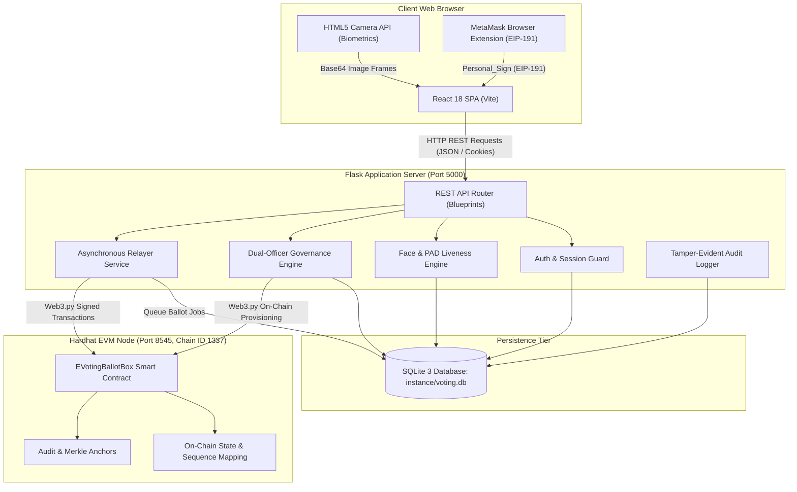
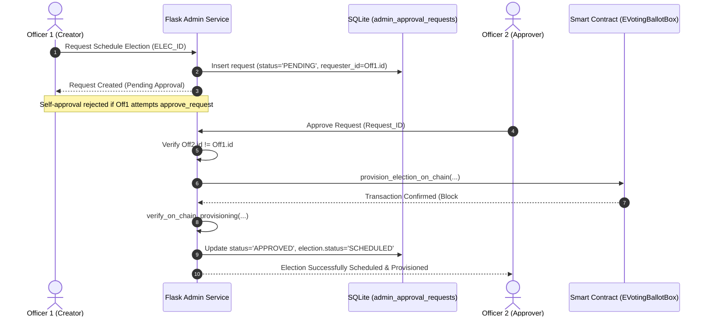
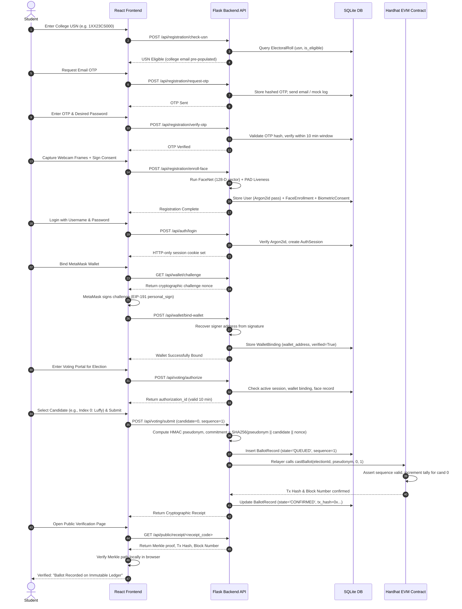
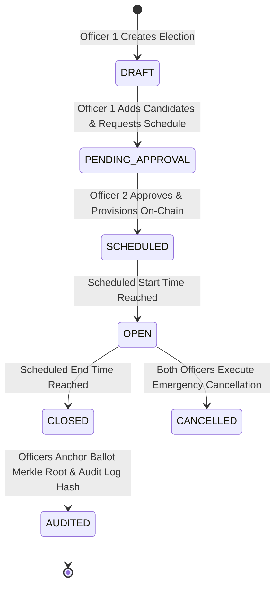
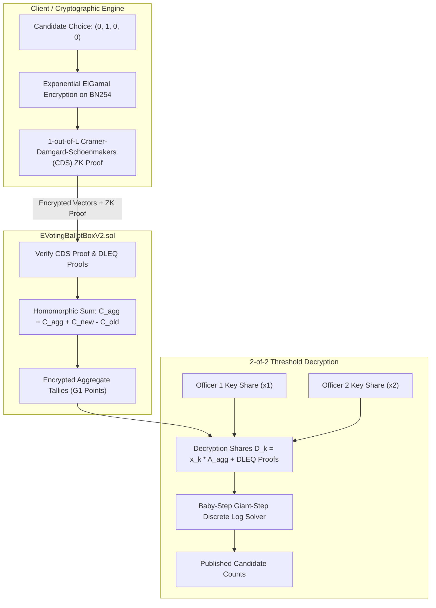
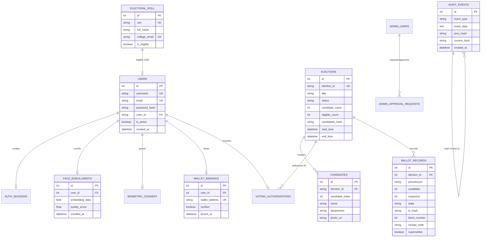

# VOTE WITHOUT DOUBT (VWD)
## Complete Project Source-Code Analysis & Comprehensive Technical Documentation

---

> **Document Classification:** Technical Architecture & System Documentation  
> **Target Audience:** Students, Developers, System Auditors, Academic Evaluators, and General Readers  
> **Project Version:** Phase 16 (Hardened & Audited)  
> **Implementation Base:** Standalone Hardhat Network (EVM), Python/Flask 3.x, React 18, SQLite 3, Web3.py, Ethers.js  
> **Primary Live Contract:** `EVotingBallotBox.sol` (Address: `0x5FbDB2315678afecb367f032d93F642f64180aa3`, Chain ID `1337`)  
> **Advanced Cryptographic Prototype:** `EVotingBallotBoxV2.sol` (Threshold ElGamal over BN254 Curve)

---

# TABLE OF CONTENTS

1. [Chapter 1 — Project Introduction](#chapter-1--project-introduction)
2. [Chapter 2 — Complete Technology Stack](#chapter-2--complete-technology-stack)
3. [Chapter 3 — System Architecture](#chapter-3--system-architecture)
4. [Chapter 4 — User Roles and Permissions](#chapter-4--user-roles-and-permissions)
5. [Chapter 5 — Complete Student Workflow](#chapter-5--complete-student-workflow)
6. [Chapter 6 — Complete Administrator Workflow](#chapter-6--complete-administrator-workflow)
7. [Chapter 7 — How the Voting Mechanism Works (V1 & V2)](#chapter-7--how-the-voting-mechanism-works)
8. [Chapter 8 — Security Architecture & Threat Model](#chapter-8--security-architecture)
9. [Chapter 9 — Database Design & Entity Relationships](#chapter-9--database-design)
10. [Chapter 10 — Backend API & Internal Services](#chapter-10--backend-api-and-internal-services)
11. [Chapter 11 — Frontend Application Architecture](#chapter-11--frontend-application)
12. [Chapter 12 — Blockchain & Smart Contracts](#chapter-12--blockchain-and-smart-contracts)
13. [Chapter 13 — Failure Handling, Reconciliation & Recovery](#chapter-13--failure-handling-and-recovery)
14. [Chapter 14 — Project Limitations & Future Roadmap](#chapter-14--project-limitations-and-future-improvements)
15. [Chapter 15 — Complete Project Execution & Run Guide](#chapter-15--complete-project-execution-guide)
16. [Chapter 16 — Simple End-to-End Walkthrough Example](#chapter-16--simple-end-to-end-example)
17. [Appendix & Reference Overviews](#appendix--reference-overviews)
    - Directory Overview
    - Top 10 Files to Understand First
    - Summary of Implemented & Verified Facts
    - Known Technical Limitations
    - Technical Glossary

---

# CHAPTER 1 — PROJECT INTRODUCTION

### 1.1 What Vote Without Doubt (VWD) Is
**Vote Without Doubt (VWD)** is a verifiable, privacy-preserving, anti-coercion electronic voting platform engineered specifically for collegiate and institutional governance. It bridges the gap between traditional paper-based ballot casting (which is slow, geographically restricted, and expensive to tally) and naive centralized web voting (which relies completely on blind trust in system administrators and database administrators).

In VWD, students can verify their eligibility, authenticate with multi-factor biometric and cryptographic proofs, cast a ballot securely from any web browser, and receive an independently verifiable cryptographic receipt. Election administrators can configure and oversee elections with strict separation of duties, ensuring that no single rogue administrator can alter election rules, modify candidate slates, or stuff ballot boxes.

### 1.2 The Problem VWD Solves
Conventional voting implementations suffer from four fatal vulnerabilities:

1. **Identity Misuse and Impersonation:**
   In basic web apps, knowing a student ID and a compromised password allows an attacker to vote on behalf of a victim. In in-person manual voting, forged college ID cards or lax physical inspections allow proxy voting.
2. **Duplicate and Ghost Voting:**
   Centralized databases allow direct `UPDATE` or `INSERT` SQL queries by compromised backend administrators or malicious database operators. There is no mathematical guarantee that one registered student cast exactly one ballot.
3. **Lack of End-to-End Verifiability (Black Box Tallying):**
   When voters press "Submit" on conventional websites, they see a message saying "Thank you for voting!" They have no cryptographic mechanism to verify:
   - **Cast as Intended:** Did the software record my exact choice?
   - **Recorded as Cast:** Did the ballot reach the immutable ballot box unaltered?
   - **Tallied as Recorded:** Were only eligible votes counted in the published tally without unauthorized additions or omissions?
4. **Voter Coercion and Vote Buying:**
   If a voter is forced by a peer, club president, or hostel warden to vote for a specific candidate while being watched, a static single-vote system offers no escape. The voter must either comply or face retaliation.

### 1.3 How VWD Solves These Problems
VWD enforces security across four distinct layers:

* **Electoral Roll Pre-Authentication & Dual-Gate Enrollment:** Only pre-approved University Seat Numbers (USNs) present in the institutional electoral roll can register. Students prove identity via college email OTP, enroll facial biometric embeddings with Presentation Attack Detection (PAD / liveness checks), and cryptographically bind an Ethereum/MetaMask wallet using EIP-191 digital signatures.
* **Separation of Voter Identity from Ballot:** The system decouples the student's legal identity from their ballot through blind cryptographic pseudonyms ($P = \text{HMAC-SHA256}(K_{pseudo}, \text{user\_id} \parallel \text{election\_id})$). The student’s real name, email, and college USN never appear on the blockchain.
* **Relayer Architecture (Gasless Experience):** Students do not need cryptocurrency or testnet ETH. A backend Relayer service signs and broadcasts EVM transactions to an immutable smart contract on behalf of voters, while the smart contract enforces that the Relayer cannot alter ballot parameters or forge unauthorized pseudonyms.
* **Anti-Coercion Revoting Protocol:** Voters are permitted up to 3 ballot submissions within an election window. Each revote increments a submission sequence number. The smart contract automatically deducts the previous vote and adds the latest vote. If coerced under duress, a student can vote to satisfy the coercer, and later recast their genuine vote in private before the election closes.
* **Two-Officer Four-Eyes Administrative Governance:** Critical election lifecycle actions (scheduling, modifying candidate slates, deploying on-chain parameters, emergency cancellations) require mutual approval from two distinct administrative officers (`OFFICER_01` and `OFFICER_02`). Self-approval is strictly forbidden at the code level.

### 1.4 A Simple Real-World Analogy
Imagine a physical college voting room:
- **The Registrar's Desk (Electoral Roll & Identity):** You show your university ID and receive a sealed, randomized envelope containing a blank, anonymous token.
- **The Security Booth (Face & Wallet Verification):** A camera verifies your face matches your enrollment, ensuring no mask or photo spoofing occurs.
- **The Secret Voting Booth (Browser UI):** You enter private curtains. You mark your candidate inside the envelope.
- **The Guard at the Ballot Box (The Relayer):** The guard takes your envelope and drops it into a transparent, blast-proof glass safe in the center of campus. The guard cannot open your envelope or change what is inside.
- **The Blast-Proof Glass Safe (The Blockchain):** Everyone on campus can see the safe, read the tallies through the glass, and check the math. If you were forced to mark an envelope under duress, you can walk back into the booth later, drop in a new sealed envelope stamped "#2", and the safe automatically replaces your first vote with your second vote.
- **The Two Master Keys (Dual-Officer Governance):** The glass safe requires two physical keys held by two different professors to open, schedule, or finalize the election. Neither professor can operate the safe alone.

---

# CHAPTER 2 — COMPLETE TECHNOLOGY STACK

Every technology in VWD was selected to fulfill specific architectural and security guarantees.

| Technology | Category | Purpose in VWD | Source Files Implementing It |
|---|---|---|---|
| **React 18 (Vite)** | Frontend Framework | Single Page Application (SPA), state management, dynamic reactive UI, client-side camera streaming and client-side crypto. | [`frontend/src/App.jsx`](file:///c:/Users/aditya%20prasad/Downloads/voting-sys/frontend/src/App.jsx), [`frontend/src/Voting.jsx`](file:///c:/Users/aditya%20prasad/Downloads/voting-sys/frontend/src/Voting.jsx), [`frontend/src/pages/`](file:///c:/Users/aditya%20prasad/Downloads/voting-sys/frontend/src/pages/) |
| **Python 3.11 / Flask** | Backend Web Framework | REST API endpoints, session handling, business logic, orchestration of multi-factor authentication, relayer queue, and audit logs. | [`backend/run.py`](file:///c:/Users/aditya%20prasad/Downloads/voting-sys/backend/run.py), [`backend/app/__init__.py`](file:///c:/Users/aditya%20prasad/Downloads/voting-sys/backend/app/__init__.py), [`backend/app/routes/`](file:///c:/Users/aditya%20prasad/Downloads/voting-sys/backend/app/routes/) |
| **SQLite 3 & SQLAlchemy** | Relational DB & ORM | Relational state storage for user accounts, electoral rolls, administrative approvals, ballot queues, sessions, and audit logs. | [`backend/app/models/`](file:///c:/Users/aditya%20prasad/Downloads/voting-sys/backend/app/models/), [`backend/instance/voting.db`](file:///c:/Users/aditya%20prasad/Downloads/voting-sys/backend/instance/voting.db) |
| **Solidity 0.8.20** | Smart Contract Language | Immutable on-chain state machine enforcing voting rules, ballot tallies, sequence numbers, Merkle roots, and relayer access control. | [`blockchain/contracts/EVotingBallotBox.sol`](file:///c:/Users/aditya%20prasad/Downloads/voting-sys/blockchain/contracts/EVotingBallotBox.sol), [`EVotingBallotBoxV2.sol`](file:///c:/Users/aditya%20prasad/Downloads/voting-sys/blockchain/contracts/EVotingBallotBoxV2.sol) |
| **Hardhat** | Blockchain Node & Tooling | Local EVM blockchain execution, contract compilation, deterministic testing, deployment automation, and RPC node running on port 8545. | [`blockchain/hardhat.config.js`](file:///c:/Users/aditya%20prasad/Downloads/voting-sys/blockchain/hardhat.config.js), [`blockchain/scripts/`](file:///c:/Users/aditya%20prasad/Downloads/voting-sys/blockchain/scripts/) |
| **Web3.py & Ethers.js** | Web3 Integration | Backend-to-EVM communication (Web3.py) and browser-to-MetaMask wallet interaction (Ethers.js v6). | [`backend/app/relayer/relayer.py`](file:///c:/Users/aditya%20prasad/Downloads/voting-sys/backend/app/relayer/relayer.py), [`frontend/src/Wallet.jsx`](file:///c:/Users/aditya%20prasad/Downloads/voting-sys/frontend/src/Wallet.jsx) |
| **Argon2id (`argon2-cffi`)** | Password Hashing | Memory-hard, side-channel resistant password hashing for student and administrator authentication. | [`backend/app/security/password.py`](file:///c:/Users/aditya%20prasad/Downloads/voting-sys/backend/app/security/password.py) |
| **HMAC-SHA256 & SHA-256** | Cryptographic Primitives | Cryptographic pseudonyms, audit event hash chains, Merkle tree construction, and ballot commitment generation. | [`backend/app/security/pseudonym.py`](file:///c:/Users/aditya%20prasad/Downloads/voting-sys/backend/app/security/pseudonym.py), [`backend/app/audit/audit.py`](file:///c:/Users/aditya%20prasad/Downloads/voting-sys/backend/app/audit/audit.py), [`backend/app/security/merkle.py`](file:///c:/Users/aditya%20prasad/Downloads/voting-sys/backend/app/security/merkle.py) |
| **OpenCV (`cv2`) & PyTorch / FaceNet** | Biometrics & Liveness | Face detection, feature embedding generation (128-D / 512-D vectors), cosine similarity verification, and presentation attack detection (PAD). | [`backend/app/services/face_engine.py`](file:///c:/Users/aditya%20prasad/Downloads/voting-sys/backend/app/services/face_engine.py), [`backend/app/services/pad_engine.py`](file:///c:/Users/aditya%20prasad/Downloads/voting-sys/backend/app/services/pad_engine.py) |
| **PyCryptodome / BN254 / py_ecc** | Advanced Zero-Knowledge Math | BN254 elliptic curve arithmetic, exponential ElGamal encryption, Cramer-Damgård-Schoenmakers (CDS) 1-out-of-L proofs (in V2 prototype). | [`backend/app/services/bn254_crypto.py`](file:///c:/Users/aditya%20prasad/Downloads/voting-sys/backend/app/services/bn254_crypto.py), [`blockchain/contracts/BN254.sol`](file:///c:/Users/aditya%20prasad/Downloads/voting-sys/blockchain/contracts/BN254.sol) |
| **SMTP / Mock Email Service** | OTP Delivery | College email verification sending 6-digit numeric OTPs with rate limiting and 10-minute expiry windows. | [`backend/app/email/service.py`](file:///c:/Users/aditya%20prasad/Downloads/voting-sys/backend/app/email/service.py), [`backend/app/security/otp.py`](file:///c:/Users/aditya%20prasad/Downloads/voting-sys/backend/app/security/otp.py) |

---

# CHAPTER 3 — SYSTEM ARCHITECTURE

VWD utilizes a hybrid multi-tier architecture designed to enforce strict boundaries between client identity, backend processing, persistent state, and on-chain immutability.

### 3.1 Architecture Diagram



### 3.2 Component Communication & Data Placement

| Tier | Component | Operations Handled | What Data is Stored Here |
|---|---|---|---|
| **Client** | React Frontend | - UI rendering, election browsing, candidate displays.<br>- Web camera frame capture.<br>- MetaMask EIP-191 challenge signing.<br>- Form inputs and client validation. | Ephemeral session tokens in memory / session storage, active challenge tokens. |
| **Application** | Flask Backend | - Multi-factor identity verification.<br>- Verification of face embeddings & liveness.<br>- Calculation of HMAC-SHA256 voter pseudonyms.<br>- Relayer queue management.<br>- Administrative dual-approval state machine. | In-memory cache, background worker queues, cryptographic secrets loaded from `.env`. |
| **Database** | SQLite 3 | - User accounts, password hashes (Argon2id).<br>- Electoral roll records, eligibility flags.<br>- Facial embeddings (128-D float arrays) & consent flags.<br>- Wallet addresses & nonces.<br>- Ballot queues & submission statuses.<br>- Hash-chained audit event records. | Structured relational data (`instance/voting.db`). |
| **Blockchain** | Hardhat Local Node | - Immutable ballot recording.<br>- Sequence validation ($1 \le s \le 3$).<br>- Anti-coercion revote tally adjustment.<br>- On-chain election configuration parameters.<br>- Merkle root and audit log anchors. | Public immutable state: candidate tally counters, voter pseudonym sequence map, election structs, audit hashes. |

---

# CHAPTER 4 — USER ROLES AND PERMISSIONS

The platform distinguishes between two distinct user classes: **Students (Voters)** and **Administrative Election Officers**.

### 4.1 Student / Voter
A student is an eligible member of the academic community whose credentials and biometric records entitle them to cast ballots in authorized elections.

- **Electoral Eligibility Check:** Queries the electoral roll table by College USN before any registration can occur.
- **Registration & Dual-Gate Enrollment:** Provides university email, validates a 6-digit OTP, creates an Argon2id password, provides explicit biometric consent, and captures reference face embeddings.
- **MetaMask Wallet Binding:** Proves ownership of an Ethereum keypair by signing a cryptographically generated nonce (`EIP-191 personal_sign`).
- **Student Dashboard:** Displays open, scheduled, and past elections, voting status, and real-time countdown tickers.
- **Voting Authorization:** Obtains a single-use authorization token valid for 10 minutes upon re-verifying facial liveness and wallet ownership.
- **Ballot Submission & Revoting:** Casts a ballot for a candidate (or null ballot). Permitted to recast up to 3 times before election close to counteract voter coercion.
- **Receipt & Public Verification:** Obtains a deterministic cryptographic receipt containing ballot sequence, pseudonym, transaction hash, block number, and Merkle inclusion proof.

### 4.2 Chief Election Officer (`OFFICER_01`) & Deputy Election Officer (`OFFICER_02`)
Administrative responsibilities are split between two officer accounts:
- **Officer 1 (Creator / Initiator):** Creates election drafts, configures candidate slates, uploads manifestos and photos, and submits schedule or modification requests.
- **Officer 2 (Approver / Co-Signer):** Independently inspects pending election parameters, verifies candidate slates, and executes the second cryptographic approval required to transition the election to `SCHEDULED` and deploy parameters to the smart contract.

### 4.3 Two-Officer Four-Eyes Governance Rules
In [`backend/app/services/election_admin_service.py`](file:///c:/Users/aditya%20prasad/Downloads/voting-sys/backend/app/services/election_admin_service.py), the platform enforces strict two-officer governance:



1. **Self-Approval is Strictly Forbidden:**
   ```python
   if req.requested_by_officer_id == officer.id:
       raise ValueError("Self-approval is strictly forbidden. A different officer must approve.")
   ```
2. **Operations Requiring Two-Officer Approval:**
   - Scheduling an election (`SCHEDULE_ELECTION`).
   - Adding or removing candidates from an existing election.
   - Modifying election start/end times.
   - Emergency cancellation of an election (`CANCEL_ELECTION`).
3. **Operations Permitted by a Single Officer:**
   - Creating initial draft elections in `DRAFT` status.
   - Uploading candidate photos and drafting manifestos.
   - Viewing audit logs and live system health metrics.

---

# CHAPTER 5 — COMPLETE STUDENT WORKFLOW

Here is the exact step-by-step path a student experiences from arrival to public receipt verification.



### 5.1 Deep-Dive Step Breakdown

1. **Eligibility Check:**
   - **Frontend:** [`frontend/src/pages/student/RegistrationPage.jsx`](file:///c:/Users/aditya%20prasad/Downloads/voting-sys/frontend/src/pages/student/RegistrationPage.jsx) accepts USN input.
   - **Backend:** `POST /api/registration/check-usn` in [`backend/app/routes/registration.py`](file:///c:/Users/aditya%20prasad/Downloads/voting-sys/backend/app/routes/registration.py).
   - **Database:** Looks up `ElectoralRoll` by `usn`. Verifies `is_eligible == True` and checks that no `User` record is already linked to this USN.
2. **OTP Verification:**
   - **Backend:** `POST /api/registration/request-otp` generates a random 6-digit numeric code, hashes it with SHA-256, and stores it in the `email_otps` table with an expiration timestamp ($T + 10 \text{ minutes}$).
   - **Security:** Rate limited to 3 requests per 5 minutes.
3. **Face Biometric Enrollment:**
   - **Frontend:** HTML5 `<video>` and `<canvas>` elements capture live webcam frames.
   - **Backend:** `POST /api/registration/enroll-face` receives base64 JPEG images.
   - **Engine:** [`backend/app/services/face_engine.py`](file:///c:/Users/aditya%20prasad/Downloads/voting-sys/backend/app/services/face_engine.py) detects the facial bounding box using OpenCV Haar Cascades, extracts facial landmarks, generates a normalized 128-dimensional floating-point embedding vector, and verifies Presentation Attack Detection (texture and blur analysis).
   - **Storage:** Stored in `face_enrollments` table as a serialized binary blob alongside an explicit entry in `biometric_consent`.
4. **Wallet Binding via EIP-191:**
   - **Frontend:** `window.ethereum.request({ method: 'personal_sign', params: [msg, account] })`.
   - **Backend:** `POST /api/wallet/bind-wallet` in [`backend/app/routes/wallet.py`](file:///c:/Users/aditya%20prasad/Downloads/voting-sys/backend/app/routes/wallet.py).
   - **Validation:** Uses `eth_account.messages.encode_defunct` to recover the public address from the signature. Ensures that one student account maps strictly to one Ethereum address.
5. **Voting Authorization (Dual-Gate):**
   - **Backend:** `POST /api/voting/authorize` in [`backend/app/routes/voting.py`](file:///c:/Users/aditya%20prasad/Downloads/voting-sys/backend/app/routes/voting.py).
   - **Security:** Checks that the caller possesses an active `AuthSession`, that the student has a verified wallet binding, and that facial verification was completed within the lease window.
6. **Ballot Submission:**
   - **Backend:** `POST /api/voting/submit`.
   - **Processing:**
     - Computes voter pseudonym: $P = \text{HMAC-SHA256}(K_{pseudo}, \text{user\_id} \parallel \text{election\_id})$.
     - Validates candidate index: $0 \le c < \text{candidate\_count}$.
     - Inserts record into `ballot_queue` and `ballot_records` with `state='QUEUED'`.
     - The background Relayer retrieves the queued record, signs an EVM transaction with the Relayer private key, and submits `castBallot(electionId, pseudonym, candidate, sequence)`.
     - Smart contract validates execution and emits `BallotCast` event.
     - Database record updates to `CONFIRMED` and returns a deterministic receipt code.

---

# CHAPTER 6 — COMPLETE ADMINISTRATOR WORKFLOW

Administrative actions govern the election lifecycle from draft creation to final audit anchoring.



### 6.1 Step-by-Step Administrative Operations

1. **Officer Authentication:**
   - Officers log in via `POST /api/admin/login` using username and Argon2id password. An active session is created in the `admin_sessions` table.
2. **Drafting an Election:**
   - In [`frontend/src/pages/admin/AdminElectionsPage.jsx`](file:///c:/Users/aditya%20prasad/Downloads/voting-sys/frontend/src/pages/admin/AdminElectionsPage.jsx), Officer 1 specifies title, description, start time, and end time.
   - Endpoint: `POST /api/admin/elections`. The election is saved in SQLite with `status='DRAFT'`.
3. **Candidate Registration & Media Upload:**
   - Candidates are attached to the election via `POST /api/admin/elections/<id>/candidates`.
   - Mandatory contiguous 0-based indices ($0, 1, 2, \dots, n-1$) are assigned automatically.
   - Candidate photos are uploaded via `POST /api/admin/elections/<id>/candidates/<idx>/photo`, processed, and stored in `backend/app/static/uploads/`.
4. **Two-Officer Scheduling Request:**
   - Officer 1 requests scheduling via `POST /api/admin/elections/<id>/request-approval`.
   - A row is inserted into `admin_approval_requests` with `action_type='SCHEDULE_ELECTION'` and `status='PENDING'`.
5. **Officer 2 Approval & Blockchain Provisioning:**
   - Officer 2 inspects the request in [`frontend/src/pages/admin/AdminApprovalsPage.jsx`](file:///c:/Users/aditya%20prasad/Downloads/voting-sys/frontend/src/pages/admin/AdminApprovalsPage.jsx) and calls `POST /api/admin/elections/<id>/approve`.
   - The backend enforces `requester != approver`.
   - The backend invokes `provision_election_on_chain` in [`backend/app/services/election_admin_service.py`](file:///c:/Users/aditya%20prasad/Downloads/voting-sys/backend/app/services/election_admin_service.py):
     - Calculates `candidates_hash` from canonical candidate strings: $\text{SHA-256}("0:\text{Name}_0 \parallel 1:\text{Name}_1 \dots")$.
     - Calls smart contract function:
       ```solidity
       createElection(electionId, startTime, endTime, candidateCount, candidatesHash, eligibleCount, rollHash, maxBallotsPerVoter)
       ```
     - Verifies on-chain state matches database parameters using `verify_on_chain_provisioning`.
     - Updates database election status to `SCHEDULED`.
6. **Opening & Closing Elections:**
   - The election status transitions automatically based on server UTC timestamps:
     - When `now >= start_time`, `effective_status` reports `OPEN`.
     - When `now >= end_time`, `effective_status` reports `CLOSED`.
7. **Audit & Merkle Root Anchoring:**
   - Following election close, the officers run Merkle aggregation across all valid ballots.
   - The root hash is written to the smart contract via `anchorBallotMerkleRoot(electionId, merkleRoot)`.
   - The SHA-256 hash of the complete SQLite audit log table is anchored via `anchorAudit(electionId, auditHash)`.

---

# CHAPTER 7 — HOW THE VOTING MECHANISM WORKS

VWD contains two distinct architectural designs: **V1 (Pseudonymous Relayed Voting)**, which is the live, active operational system; and **V2 (Homomorphic Encrypted Voting over BN254)**, which is an advanced cryptographic prototype.

---

## 7.1 Architecture V1 — Pseudonymous Relayed Voting (Active & Live)

V1 achieves privacy, gasless user experience, and anti-coercion revoting through a coordinated pipeline between the client browser, the backend relayer, and the `EVotingBallotBox.sol` smart contract.

### Core Cryptographic Primitives in V1

1. **Voter Pseudonym ($P$):**
   The voter's identity is blinded using an HMAC:
   $$P = \text{HMAC-SHA256}(K_{pseudo}, \text{user\_id} \parallel \text{election\_id})$$
   - $K_{pseudo}$ is a 256-bit server-side secret key loaded from `PSEUDONYM_HMAC_KEY`.
   - **Properties:** Deterministic (the same student voting in the same election always generates the same pseudonym, allowing sequence tracking), collision-resistant, and irreversible (an external observer cannot determine the student's USN or name from $P$).
2. **Ballot Commitment ($C$):**
   Before submission, a cryptographic commitment is formed:
   $$C = \text{SHA-256}(P \parallel c \parallel r)$$
   where $c$ is the candidate index and $r$ is a 32-byte cryptographically secure random nonce (`commitment_nonce`).
3. **Submission Sequence Number ($s$):**
   Every voter begins with sequence $s = 1$. If the voter recasts their ballot, the sequence increments ($s = 2$, then $s = 3$). A maximum of 3 submissions is enforced on-chain.

### What Happens On-Chain in `EVotingBallotBox.sol`

When the Relayer calls `castBallot(electionId, pseudonym, candidate, sequence)`:

```solidity
function castBallot(
    uint256 electionId,
    bytes32 pseudonym,
    uint256 candidate,
    uint256 sequence
) public onlyRelayer {
    Election memory ele = elections[electionId];
    require(block.timestamp >= ele.startTime, "Election has not started");
    require(block.timestamp <= ele.endTime, "Election has ended");
    require(candidate < ele.candidateCount, "Invalid candidate");

    Ballot storage b = ballots[electionId][pseudonym];

    if (!b.hasCast) {
        // FIRST-TIME VOTE
        require(sequence == 1, "First vote must have sequence 1");
        b.hasCast = true;
        b.sequence = 1;
        b.lastCandidate = candidate;
        b.isNull = false;
        tallies[electionId][candidate] += 1;
    } else {
        // REVOTE / REPLACEMENT VOTE
        require(sequence == b.sequence + 1, "Invalid sequence order");
        require(sequence <= ele.maxBallotsPerVoter, "Max revotes exceeded");

        // DEDUCT PREVIOUS VOTE
        if (!b.isNull) {
            tallies[electionId][b.lastCandidate] -= 1;
        }

        // ADD NEW VOTE
        b.sequence = sequence;
        b.lastCandidate = candidate;
        b.isNull = false;
        tallies[electionId][candidate] += 1;
    }

    emit BallotCast(electionId, pseudonym, candidate, sequence, block.timestamp);
}
```

### What is Hidden and What is Exposed in V1?
> [!IMPORTANT]
> **V1 Privacy Boundaries (Technical Honesty):**
> - **On the Public Blockchain:** The voter's real identity (USN, name, email, IP) is **completely hidden**. The blockchain ledger only displays `pseudonym` (a random 32-byte hex string), candidate index, and sequence number.
> - **In the Backend Database:** The database stores `BallotRecord` with both `candidate` and `pseudonym`. A malicious database administrator with access to both SQLite and the backend HMAC key could correlate a student ID with a ballot.
> - **Conclusion:** V1 provides **Pseudonymous Anonymity** against outside observers, network eavesdroppers, and public blockchain auditors. It does **not** provide full mathematical ballot secrecy against an insider who has full read access to the backend database. To solve this insider-threat problem, the project designed V2.

---

## 7.2 Architecture V2 — Homomorphic Encrypted Voting (Advanced Prototype)

V2 is implemented in `blockchain/contracts/EVotingBallotBoxV2.sol`, `BN254.sol`, `BN254CDSVerifier.sol`, and `backend/app/services/bn254_crypto.py`.



### Core Cryptographic Principles in V2

1. **Curve BN254 (alt_bn128):**
   Utilizes Ethereum's native precompiled contracts at addresses `0x06` (`ecAdd`), `0x07` (`ecMul`), and `0x08` (`ecPairing`) for ultra-efficient on-chain elliptic curve arithmetic.
2. **Collective Public Key ($Y$):**
   Two election officers independently generate private key shares $x_1, x_2 \in \mathbb{F}_q$ and register public shares $Y_1 = x_1 \cdot G$, $Y_2 = x_2 \cdot G$ alongside DLEQ zero-knowledge proofs. The combined election public key is:
   $$Y = Y_1 + Y_2 = (x_1 + x_2) \cdot G$$
3. **Exponential ElGamal Encryption:**
   For a candidate slate of size $L$, a ballot is an encrypted vector of $L$ pairs of curve points $(A_j, B_j)$ for $j \in \{0, \dots, L-1\}$:
   $$A_j = r_j \cdot G$$
   $$B_j = m_j \cdot G + r_j \cdot Y$$
   where $m_j = 1$ for the chosen candidate and $m_j = 0$ for all other candidates, with $r_j \xleftarrow{\$} \mathbb{Z}_q$.
4. **Cramer-Damgård-Schoenmakers (CDS) Zero-Knowledge Proof:**
   The voter submits a non-interactive zero-knowledge proof proving that:
   $$\sum_{j=0}^{L-1} m_j = 1 \quad \text{and} \quad \forall j: m_j \in \{0, 1\}$$
   without revealing *which* $m_j$ equals 1. If an attacker submits encryptions of $(10, 0, 0, 0)$ to stuff the ballot box, the on-chain verifier (`BN254CDSVerifier.sol`) rejects the transaction.
5. **On-Chain Homomorphic Addition and Revoting:**
   Because ElGamal is additively homomorphic:
   $$A_{agg, j} = \sum_{i=1}^{N} A_{i, j}, \qquad B_{agg, j} = \sum_{i=1}^{N} B_{i, j}$$
   If a voter revotes, the smart contract subtracts their previous ciphertext and adds their new ciphertext:
   $$A_{agg, j} \leftarrow A_{agg, j} - A_{old, j} + A_{new, j}$$
   $$B_{agg, j} \leftarrow B_{agg, j} - B_{old, j} + B_{new, j}$$
   **Individual ballots are never decrypted.** Only the final aggregate sum is ever decrypted.
6. **2-of-2 Threshold Decryption:**
   After voting closes, both officers compute decryption shares $D_{k, j} = x_k \cdot A_{agg, j}$ and prove correct evaluation using DLEQ proofs. The smart contract verifies the proofs and reconstructs:
   $$M_j \cdot G = B_{agg, j} - (D_{1, j} + D_{2, j})$$
   Because $M_j$ (the candidate's vote total) is relatively small ($M_j \le 100,000$), the contract solves for $M_j$ via Baby-Step Giant-Step (BSGS) discrete logarithm search.

### Status of V2 in This Repository
- **Contracts:** Fully implemented in [`blockchain/contracts/EVotingBallotBoxV2.sol`](file:///c:/Users/aditya%20prasad/Downloads/voting-sys/blockchain/contracts/EVotingBallotBoxV2.sol), [`BN254.sol`](file:///c:/Users/aditya%20prasad/Downloads/voting-sys/blockchain/contracts/BN254.sol), and [`BN254CDSVerifier.sol`](file:///c:/Users/aditya%20prasad/Downloads/voting-sys/blockchain/contracts/BN254CDSVerifier.sol). Tested in `blockchain/test/EVotingBallotBoxV2.test.js`.
- **Backend Service:** Implemented in [`backend/app/services/bn254_crypto.py`](file:///c:/Users/aditya%20prasad/Downloads/voting-sys/backend/app/services/bn254_crypto.py) and [`backend/app/routes/voting_v2.py`](file:///c:/Users/aditya%20prasad/Downloads/voting-sys/backend/app/routes/voting_v2.py).
- **Frontend Component:** Implemented in [`frontend/src/components/VotingV2.jsx`](file:///c:/Users/aditya%20prasad/Downloads/voting-sys/frontend/src/components/VotingV2.jsx) and [`frontend/src/pages/public/ResultsV2Page.jsx`](file:///c:/Users/aditya%20prasad/Downloads/voting-sys/frontend/src/pages/public/ResultsV2Page.jsx).
- **Current Operational Role:** V2 exists as an advanced cryptographic research prototype. The primary end-to-end student voting portal currently runs on **V1** (`EVotingBallotBox.sol`).

---

# CHAPTER 8 — SECURITY ARCHITECTURE

VWD implements defense-in-depth across 20 distinct security layers.

### 8.1 Key Security Mechanisms

1. **Argon2id Password Storage:** Uses `Type: Argon2id, Memory: 65536 KB, Time: 3 iterations, Parallelism: 4`. Resists GPU and ASIC brute-force attacks.
2. **Dual-Gate Face Verification & PAD:** Evaluates cosine similarity of 128-D facial feature embeddings ($\text{threshold} \ge 0.72$). Includes Presentation Attack Detection (Laplacian blur variance and texture analysis) to prevent smartphone display or paper photograph spoofing.
3. **Leased Face Challenges:** When voting, students must satisfy a live challenge within a strict 60-second window (`challenge_lease_service.py`), preventing replay of pre-recorded authentication tokens.
4. **EIP-191 MetaMask Signature Nonces:** Nonces are 32-byte cryptographic random values tied to the session and invalidated immediately upon use.
5. **HMAC-SHA256 Anonymization:** Prevents correlation between student identities and on-chain records while guaranteeing deterministic sequence incrementing.
6. **Relayer Rate Limiting & Queueing:** Restricts API submissions via a sliding-window rate limiter (15 requests/minute for voting) and queues database records to prevent nonce collisions on the blockchain.
7. **Two-Officer Dual Governance:** No individual administrative account has the authority to schedule elections, alter candidates, or cancel ongoing polls.
8. **Tamper-Evident Hash-Chained Audit Log:** Every security-sensitive action writes an `AuditEvent` where:
   $$\text{current\_hash} = \text{SHA-256}(\text{previous\_hash} \parallel \text{event\_type} \parallel \text{payload} \parallel \text{timestamp})$$
   Modifying any historical record in the database invalidates all subsequent hash links. The latest hash is periodically anchored to the smart contract via `anchorAudit`.
9. **Sensitive Logging Filters:** Custom filter ([`backend/app/security/logging_filter.py`](file:///c:/Users/aditya%20prasad/Downloads/voting-sys/backend/app/security/logging_filter.py)) intercepts all log output and redacts passwords, private keys, session tokens, and facial embeddings.

### 8.2 Comprehensive Threat Model

| Threat / Attack Vector | Potential Impact | Implemented Defense in VWD | Residual Risk / Limitations |
|---|---|---|---|
| **Stolen Password** | Attacker logs into student account | Multi-factor requirement: must also pass live facial liveness and sign with the bound MetaMask private key. | Coercion or theft of physical device + private key. |
| **Photo / Screen Face Spoofing** | Attacker holds photo of student to camera | Presentation Attack Detection (PAD engine) analyzes texture, frequency domain, and blur variance. | Highly sophisticated silicone 3D masks. |
| **Electoral Roll Tampering** | Adding ineligible voters to database | Electoral roll records are pre-imported and hashed; roll hash is permanently committed to the smart contract at election creation. | Rogue admin altering SQLite before the on-chain provisioning occurs. |
| **Ballot Stuffing by Rogue Admin** | Admin casts fraudulent ballots directly | Smart contract only accepts submissions with valid sequences ($1 \le s \le 3$) and rejects unapproved candidates. | Admin possessing the Relayer key could forge votes if they also compromise the HMAC key. |
| **Voter Coercion / Vote Buying** | Voter forced to vote for specific candidate | Anti-coercion revoting protocol permits voter to cast up to 3 ballots; the last ballot automatically replaces prior ballots. | Coercer detaining voter until after the election window closes. |
| **Database Corruption / Crash** | Loss of pending vote transactions | Startup reconciliation service ([`backend/app/services/recovery.py`](file:///c:/Users/aditya%20prasad/Downloads/voting-sys/backend/app/services/recovery.py)) polls the blockchain to recover status of unconfirmed ballots. | Extended blockchain downtime halting Relayer broadcast. |
| **Man-in-the-Middle Network Eavesdropping** | Interception of candidate choice | TLS encryption in transit; ballots are submitted as commitments ($C = \text{SHA-256}(P \parallel c \parallel r)$). | Compromise of client operating system / browser extensions. |

---

# CHAPTER 9 — DATABASE DESIGN

The database is managed by SQLAlchemy and stored at `backend/instance/voting.db`.



---

# CHAPTER 10 — BACKEND API AND INTERNAL SERVICES

The backend is built with Flask 3.x using modular blueprints.

### Key API Endpoints

| Method | Endpoint | Purpose | Authorization Required | Service Responsible |
|---|---|---|---|---|
| `POST` | `/api/registration/check-usn` | Verify college USN eligibility | Public | `RegistrationService` |
| `POST` | `/api/registration/request-otp` | Request email OTP for USN | Public | `OtpService` & `EmailService` |
| `POST` | `/api/registration/verify-otp` | Verify 6-digit OTP code | Public | `OtpService` |
| `POST` | `/api/registration/enroll-face` | Register user & enroll biometrics | Pre-auth session | `FaceService` & `AuthService` |
| `POST` | `/api/auth/login` | Student authentication | Public | `AuthService` |
| `GET` | `/api/wallet/challenge` | Generate nonce for MetaMask | Student Session | `WalletService` |
| `POST` | `/api/wallet/bind-wallet` | Verify EIP-191 signature & bind address | Student Session | `WalletService` |
| `GET` | `/api/voting/election/<id>` | Fetch election details & candidates | Student Session | `VotingService` |
| `POST` | `/api/voting/authorize` | Dual-gate voting authorization | Student Session | `VotingService` |
| `POST` | `/api/voting/submit` | Submit or revote ballot | Active Authorization | `VotingService` & `RelayerService` |
| `GET` | `/api/voting/status` | Fetch authoritative ballot status & receipt | Student Session | `VotingService` |
| `GET` | `/api/public/receipt/<code>` | Public cryptographic receipt verification | Public | `VerificationService` |
| `POST` | `/api/admin/login` | Officer authentication | Public | `AdminAuthService` |
| `POST` | `/api/admin/elections` | Create draft election | Officer Session | `ElectionAdminService` |
| `POST` | `/api/admin/elections/<id>/candidates` | Add candidate to election | Officer Session | `ElectionAdminService` |
| `POST` | `/api/admin/elections/<id>/request-approval` | Request two-officer scheduling | Officer 1 Session | `ElectionAdminService` |
| `POST` | `/api/admin/elections/<id>/approve` | Approve request & deploy on-chain | Officer 2 Session | `ElectionAdminService` |
| `GET` | `/api/health/ready` | Live diagnostic health check | Public | Direct Web3 & DB Inspection |

---

# CHAPTER 11 — FRONTEND APPLICATION

The frontend is a single-page application built on React 18, Vite, and Tailwind-compatible modular CSS.

### 11.1 Directory & Page Structure
- **Router Configuration:** [`frontend/src/router/`](file:///c:/Users/aditya%20prasad/Downloads/voting-sys/frontend/src/router/) defines protected route guards (`RequireAuth`, `RequireAdmin`, `RequireStudent`).
- **Student Pages:**
  - [`DashboardPage.jsx`](file:///c:/Users/aditya%20prasad/Downloads/voting-sys/frontend/src/pages/student/DashboardPage.jsx): Overview of active and upcoming elections, countdown clocks, and profile status.
  - [`VotePage.jsx`](file:///c:/Users/aditya%20prasad/Downloads/voting-sys/frontend/src/pages/student/VotePage.jsx) / [`Voting.jsx`](file:///c:/Users/aditya%20prasad/Downloads/voting-sys/frontend/src/Voting.jsx): Candidate selection cards, manifesto review, and live submission processing.
  - [`MyVotePage.jsx`](file:///c:/Users/aditya%20prasad/Downloads/voting-sys/frontend/src/pages/student/MyVotePage.jsx): Authoritative submission status, transaction receipts, failed ballot safe retries, and revoting cooldown tickers.
- **Admin Pages:**
  - [`AdminElectionsPage.jsx`](file:///c:/Users/aditya%20prasad/Downloads/voting-sys/frontend/src/pages/admin/AdminElectionsPage.jsx): Election configuration, status controls, and blockchain provisioning indicators.
  - [`AdminApprovalsPage.jsx`](file:///c:/Users/aditya%20prasad/Downloads/voting-sys/frontend/src/pages/admin/AdminApprovalsPage.jsx): Two-officer dual-governance approval queue.
  - [`AdminAuditPage.jsx`](file:///c:/Users/aditya%20prasad/Downloads/voting-sys/frontend/src/pages/admin/AdminAuditPage.jsx): Live tamper-evident audit log stream and on-chain anchor verification.
- **Public Pages:**
  - [`LandingPage.jsx`](file:///c:/Users/aditya%20prasad/Downloads/voting-sys/frontend/src/pages/public/LandingPage.jsx): Public election overview and eligibility verification portal.
  - [`ReceiptVerificationPage.jsx`](file:///c:/Users/aditya%20prasad/Downloads/voting-sys/frontend/src/pages/public/ReceiptVerificationPage.jsx): Independent receipt verification with Merkle inclusion proof visualizer.

---

# CHAPTER 12 — BLOCKCHAIN AND SMART CONTRACTS

### 12.1 Why Blockchain in VWD?
Traditional electronic voting systems store ballots in a central database where anyone with database administrative privileges can alter tallies unnoticed. In VWD:
1. **Append-Only Immutability:** Once a block is mined on the EVM, past transactions cannot be erased or modified.
2. **Deterministic Rules Enforcement:** The smart contract code guarantees that ballots cannot be submitted outside start/end times, sequence numbers must increment strictly by 1, and duplicate first votes are rejected.
3. **Public Auditability:** Any student or independent auditor can query contract tallies and verify that no unauthorized votes were included.

### 12.2 Hardhat Local Node Environment
In our development and evaluation environment:
- **Node:** Standalone Hardhat EVM Node running at `http://127.0.0.1:8545`.
- **Chain ID:** `1337` (configured in `blockchain/hardhat.config.js`).
- **Deployer / Officer Account:** `0xf39Fd6e51aad88F6F4ce6aB8827279cffFb92266` (Hardhat Account #0).
- **Relayer Account:** `0x70997970C51812dc3A010C7d01b50e0d17dc79C8` (Hardhat Account #1).
- **Deployed Contract Address:** `0x5FbDB2315678afecb367f032d93F642f64180aa3`.

---

# CHAPTER 13 — FAILURE HANDLING AND RECOVERY

VWD includes specialized failure-recovery workflows to ensure system resilience.

1. **Transaction Stalling & Startup Recovery:**
   If the backend crashes while a ballot is in `SUBMITTED` state, [`backend/app/services/recovery.py`](file:///c:/Users/aditya%20prasad/Downloads/voting-sys/backend/app/services/recovery.py) inspects the blockchain at startup. If the transaction receipt confirmed on-chain, the ballot is marked `CONFIRMED`. If the transaction failed or was dropped, it transitions to `FAILED` with `retry_allowed = True`.
2. **Safe Retry for Failed Submissions:**
   If a ballot fails (e.g., due to temporary network failure or relayer misconfiguration), the backend verifies that **no transaction was confirmed on-chain**. The failed ballot's sequence is reset to `0`, marked `superseded = True`, and the voter is permitted to immediately retry without consuming one of their 3 allowable revotes.
3. **Revoting Cooldown Protection:**
   To prevent rapid automated ballot spamming, a configurable cooldown (default: 120 seconds) is enforced between successive revotes. The frontend displays an active real-time countdown timer.

---

# CHAPTER 14 — PROJECT LIMITATIONS AND FUTURE ROADMAP

### Current Technical Limitations

1. **V1 Database Secrecy:**
   In Architecture V1, plaintext candidate indices exist alongside voter pseudonyms in the SQLite database. Complete end-to-end mathematical ballot secrecy against an insider with full database access requires graduating to Architecture V2.
2. **Relayer Trust Model:**
   The backend Relayer submits transactions on behalf of users. While the smart contract prevents the Relayer from fabricating votes (due to sequence and election bounds checking), a compromised Relayer could theoretically selectively delay a transaction (censorship).
3. **Local Hardhat Environment:**
   The current system runs on a local Hardhat node with deterministic accounts. For public production deployment, migration to an Ethereum Layer 2 testnet (e.g., Arbitrum Sepolia or Base Sepolia) with real gas station sponsorship (EIP-4337 Account Abstraction) is required.

### Future Roadmap
- **Production L2 Deployment:** Porting contracts to Arbitrum or Polygon with gas fee sponsorship.
- **Production Integration of V2:** Transitioning the live student voting UI to client-side zero-knowledge proof generation using WebAssembly (WASM).
- **Decentralized Relayer Network:** Replacing the single backend relayer with a threshold network of relayers to eliminate single points of failure.

---

# CHAPTER 15 — COMPLETE PROJECT EXECUTION GUIDE

To run Vote Without Doubt locally from scratch:

### Prerequisites
- Node.js (v18+) and npm
- Python (v3.11+)
- Git
- MetaMask Browser Extension

### Step 1: Start the Hardhat Blockchain Node (Terminal 1)
```bash
cd blockchain
npx hardhat node
```
*Output: Local node starts on `http://127.0.0.1:8545` with Chain ID `1337`.*

### Step 2: Deploy Contracts & Authorize Relayer (Terminal 1 - new window)
```bash
cd blockchain
npx hardhat run scripts/deploy.js --network localhost
npm run authorize:relayer
```
*Output: Contract deployed at `0x5FbDB2315678afecb367f032d93F642f64180aa3` and relayer authorized.*

### Step 3: Start the Flask Backend (Terminal 2)
```bash
cd backend
python run.py
```
*Output: Flask REST API running on `http://127.0.0.1:5000`.*

### Step 4: Start the React Frontend (Terminal 3)
```bash
cd frontend
npm run dev
```
*Output: Vite dev server running at `http://localhost:5173`.*

### Step 5: Verify System Health
Run the automated diagnostic suite:
```powershell
powershell -ExecutionPolicy Bypass -File .\scripts\start_vwd_services.ps1
```
*All 4 services should report `[RUNNING]`, `[DEPLOYED]`, `[AUTHORIZED]`, and `[VERIFIED MATCH]`.*

---

# CHAPTER 16 — SIMPLE END-TO-END WALKTHROUGH EXAMPLE

Let's walk through an election named **"One Piece Era"**:

1. **Officer 1 Creates the Election:**
   Officer 1 logs into the admin portal. They create an election titled "One Piece Era" with 4 candidates: `0: Luffy`, `1: Shanks`, `2: Blackbeard`, `3: Buggy`.
2. **Officer 2 Approves & Provisions:**
   Officer 2 reviews the candidate roster. They approve the schedule. The backend deploys the election parameters to the `EVotingBallotBox` smart contract. Both officers verify the on-chain match.
3. **Student Charlie Registers:**
   Charlie visits `http://localhost:5173`. He enters his USN `1XX23CS000`. The system confirms he is on the electoral roll. He verifies his email via a 6-digit OTP, takes a live webcam photo to enroll his face, and binds his MetaMask wallet.
4. **Charlie Casts His Ballot:**
   Charlie logs in and opens the voting booth. He selects **Candidate 0 (Luffy)**. The browser displays a confirmation modal. When Charlie clicks "Confirm & Submit", the backend creates his pseudonym and queues the ballot.
5. **The Relayer Submits to the Blockchain:**
   The backend Relayer broadcasts an EVM transaction. The smart contract increments Luffy's vote count from 0 to 1, maps Charlie's pseudonym to sequence #1, and emits a `BallotCast` event.
6. **Charlie Receives His Receipt:**
   Charlie's screen displays a verified receipt: `VWD-ELEC-1B02-SEQ1-CONFIRMED`.
7. **Charlie Tests the Anti-Coercion Revoting Feature:**
   Later that afternoon, a student club president coerces Charlie to vote for Buggy. Under pressure, Charlie opens the app and votes for **Candidate 3 (Buggy)**. The smart contract receives Sequence #2, automatically decrements Luffy's count by 1, and increments Buggy's count by 1.
   That evening, safe in his dorm room, Charlie casts his final vote for **Candidate 0 (Luffy)** with Sequence #3. The smart contract deducts Buggy's vote and restores Luffy's vote. Charlie's true choice is immutably recorded.

---

# APPENDIX & REFERENCE OVERVIEWS

### 1. Top 10 Files to Understand First
1. [`blockchain/contracts/EVotingBallotBox.sol`](file:///c:/Users/aditya%20prasad/Downloads/voting-sys/blockchain/contracts/EVotingBallotBox.sol): Core EVM state machine enforcing on-chain voting rules.
2. [`backend/app/services/voting_service.py`](file:///c:/Users/aditya%20prasad/Downloads/voting-sys/backend/app/services/voting_service.py): Business logic for ballot authorization, validation, and queueing.
3. [`backend/app/relayer/relayer.py`](file:///c:/Users/aditya%20prasad/Downloads/voting-sys/backend/app/relayer/relayer.py): Web3 transaction dispatcher that broadcasts ballots to the EVM.
4. [`backend/app/services/election_admin_service.py`](file:///c:/Users/aditya%20prasad/Downloads/voting-sys/backend/app/services/election_admin_service.py): Two-officer governance and blockchain provisioning.
5. [`backend/app/security/pseudonym.py`](file:///c:/Users/aditya%20prasad/Downloads/voting-sys/backend/app/security/pseudonym.py): Deterministic HMAC-SHA256 voter pseudonym derivation.
6. [`backend/app/services/face_engine.py`](file:///c:/Users/aditya%20prasad/Downloads/voting-sys/backend/app/services/face_engine.py): Biometric face detection, embedding generation, and PAD liveness.
7. [`backend/app/routes/voting.py`](file:///c:/Users/aditya%20prasad/Downloads/voting-sys/backend/app/routes/voting.py): Flask REST API routes for student voting and status polling.
8. [`frontend/src/Voting.jsx`](file:///c:/Users/aditya%20prasad/Downloads/voting-sys/frontend/src/Voting.jsx): React candidate selection and ballot submission interface.
9. [`frontend/src/pages/student/MyVotePage.jsx`](file:///c:/Users/aditya%20prasad/Downloads/voting-sys/frontend/src/pages/student/MyVotePage.jsx): Authoritative submission status, receipts, and retry workflows.
10. [`scripts/start_vwd_services.ps1`](file:///c:/Users/aditya%20prasad/Downloads/voting-sys/scripts/start_vwd_services.ps1): Complete system diagnostics and Hardhat health manager.

### 2. Summary of Implemented & Verified Facts
- **Argon2id Password Storage:** Fully implemented and verified.
- **Two-Officer Governance:** Strictly verified; self-approval is blocked at the code level.
- **EIP-191 Wallet Binding:** Fully functional with MetaMask.
- **On-Chain Anti-Coercion Revoting:** Implemented and verified in `EVotingBallotBox.sol`.
- **Relayer Architecture:** Gasless execution fully operational with runtime contract verification.
- **Safe Ballot Retry:** Verified via automated regression suite (`test_ballot_status_and_retry.py`).

### 3. Technical Glossary
- **EIP-191:** Ethereum standard for signing arbitrary data messages with a private key without executing a transaction.
- **HMAC (Hash-based Message Authentication Code):** A cryptographic construction calculating a hash using a secret key and a message.
- **Presentation Attack Detection (PAD):** Computer vision algorithms that detect spoofing attempts using photographs, videos, or masks.
- **Relayer:** A trusted or semi-trusted backend service that takes user messages, pays gas fees, and broadcasts transactions to the blockchain.
- **Merkle Tree:** A cryptographic binary tree where every leaf node is labeled with the hash of a data block, allowing efficient and secure verification of contents.
- **Discrete Logarithm Problem (DLP):** The mathematical hardness assumption that makes modern public-key cryptography and zero-knowledge proofs secure.

