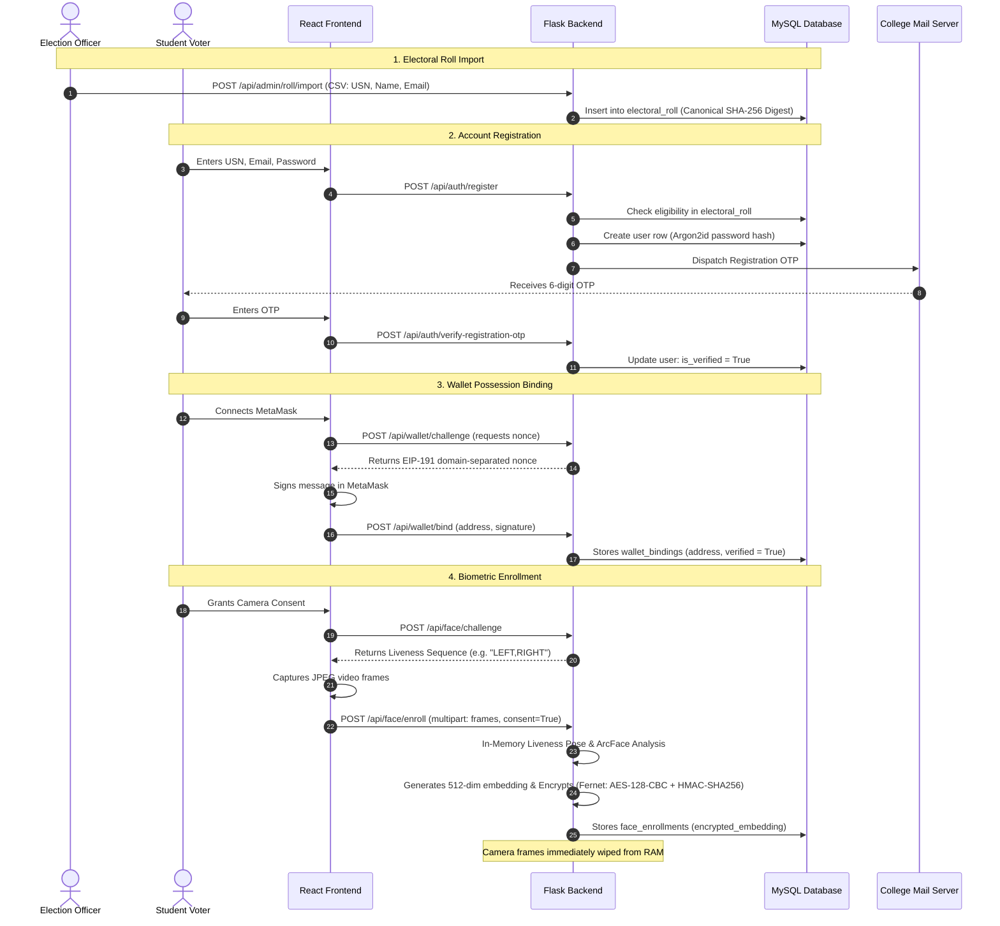
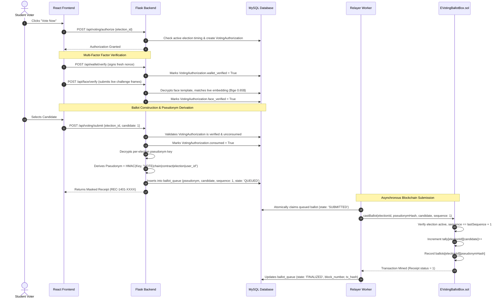
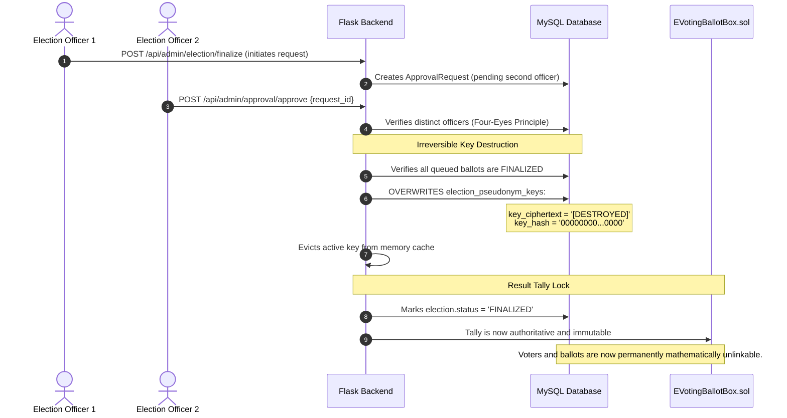

# System Data Flow & Architecture Boundaries

**Product:** Vote Without Doubt (AI & Blockchain-Based Secure E-Voting System)  
**Phase:** 15 — Privacy, Legal & Security Documentation  

---

## 1. High-Level Data Plane Separation Architecture

The system enforces strict structural separation between two distinct data planes:

```
┌────────────────────────────────────────────────────────────────────────────────────────┐
│                                     IDENTITY PLANE                                     │
│  [Electoral Roll] ─── [User Account] ─── [Auth Sessions] ─── [Wallet Bind] ─── [Face]   │
│   (USN, Name, Email)    (Argon2id Hash)    (HttpOnly Cookie)  (0x Address)  (Encrypted)│
└───────────────────────────────────────────┬────────────────────────────────────────────┘
                                            │ Controlled Ephemeral Authorization Bridge
                                            │ (NO foreign keys, NO voter ID transferred)
                                            ▼
┌────────────────────────────────────────────────────────────────────────────────────────┐
│                                      BALLOT PLANE                                      │
│  [Voting Authorization] ─── [Pseudonym Generator] ─── [Ballot Queue] ─── [Relayer]    │
│    (Flags: Wallet/Face)      (HMAC per Election)      (Candidate, Seq)   (Signs Tx)   │
└───────────────────────────────────────────────────────────┬────────────────────────────┘
                                                            │ JSON-RPC Broadcast (P2P)
                                                            ▼
┌────────────────────────────────────────────────────────────────────────────────────────┐
│                                   BLOCKCHAIN PLANE                                     │
│     [EVotingBallotBox.sol] ─── [Pseudonym Mapping] ─── [Tally Mapping] ─── [Events]     │
│       (Smart Contract)           (bytes32, Seq 1-3)     (Candidate Votes)   (BallotCast)│
└────────────────────────────────────────────────────────────────────────────────────────┘
```

---

## 2. Voter Registration & Multi-Factor Enrollment Flow



---

## 3. End-to-End Voting Flow



---

## 4. Revoting & Coercion Resistance Flow

1. **Re-Authentication:** If a voter is coerced, they re-authenticate and request authorization.
2. **Sequence Increment:** The voting service inspects the voter's prior ballots in `ballot_queue` for this election:
   $$\text{Next Sequence} = \text{Current Highest Sequence} + 1$$
3. **Revote Cap:** Maximum 3 ballots per voter per election. If `sequence > 3`, the request is rejected with `MAX_BALLOTS_EXCEEDED`.
4. **Smart Contract State Transition:** When `castBallot` executes for `sequence = 2`:
   - Prior candidate tally is decremented: `tally[electionId][lastCandidate]--`
   - New candidate tally is incremented: `tally[electionId][newCandidate]++`
   - Prior ballot in database is updated: `superseded = True`
5. **Null Revote Option:** A voter may invoke `POST /api/voting/submit-null`. The smart contract decrements the prior candidate tally without incrementing any candidate, recording a formal null ballot while exhausting the voter's participation attempt.

---

## 5. Election Finalization & Key Destruction Flow


