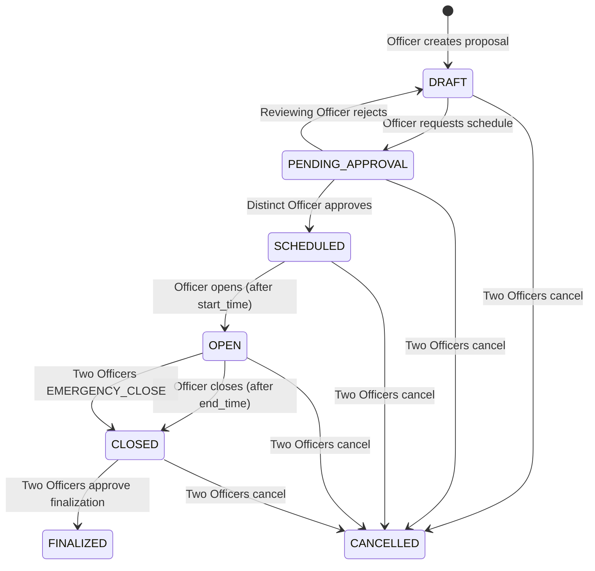

# PHASE 16 STEP 1 — READ-ONLY FRONTEND ARCHITECTURE + FUNCTIONAL GAP AUDIT

**Project:** AI & Blockchain-Based Secure E-Voting System for College Elections  
**Product:** Vote Without Doubt  
**Scope:** Frontend Architecture, Route Structure, Student Flows, Admin Portal Gaps, Security & UX Audits  
**Audit Date:** October 2026  
**Status:** COMPLETE (AUDIT ONLY — NO PRODUCTION CODE MODIFIED)

---

## 1. EXECUTIVE SUMMARY

An exhaustive, read-only architectural and functional gap audit was conducted across the entire frontend (`frontend/`), the backend API routes (`backend/app/routes/`), models (`backend/app/models/`), and the frozen Phase 0–15 security guarantees.

### Key Takeaways:
1. **Frontend Architecture:** The existing frontend is built on **React 19 (`^19.2.8`) + Vite 8 (`^8.3.0`)**. It currently operates as a **single monolithic view container (`App.jsx`)** where six distinct functional modules (`Auth`, `Registration`, `Wallet`, `Face`, `Voting`, and `PublicVerification`) are stacked vertically on a single page.
2. **Routing:** There is **no client-side router** (no `react-router-dom`). All navigation is implicit or simulated via local component state.
3. **State Management:** Decentralized local state with zero global context store. Each component queries backend endpoints directly via a centralized fetch client (`src/api/client.js`).
4. **Security Discipline (STRICT PASS):** The frontend strictly complies with frozen security invariants:
   - Passwords and OTPs are cleared immediately upon submission and never written to web storage.
   - Zero private keys, seed phrases, or cryptographic secrets are handled or stored.
   - MetaMask `personal_sign` is used strictly for identity binding (`/wallet/bind`), **never** for signing candidate choice.
   - Biometric frames are streamed directly to memory and cleared upon upload.
   - Authoritative ballot confirmation is polled; "Vote recorded" is never displayed prematurely.
   - Receipts expose only HMAC codes, minute-level timestamps, and last 4 digits of voter ID. Zero transaction hashes, pseudonyms, or candidate choices are exposed.
5. **Functional Gaps Identified:**
   - **No Student Dashboard:** No unified dashboard with election countdown, status banners, readiness checklist, or announcements.
   - **No Standalone "My Vote" Page:** Revote status and cooldown are currently embedded within the voting receipt view.
   - **No Admin Frontend:** The backend contains a comprehensive administrative API suite (`/api/admin/*` supporting 3-factor auth, two-officer approvals, immutability, audit verification, dispute investigation), but **zero admin UI exists in the frontend**.
   - **Registration Flow Disconnect:** The blueprint proposes an R0–R6 sequential onboarding wizard (including Face and Wallet setup). However, backend endpoints for Face (`/face/enroll`) and Wallet (`/wallet/bind`) require an active `AUTHORIZED` session (`/auth/login`).
   - **Backend Candidate Query Discrepancy:** While admin routes query real `Candidate` database models, the voter endpoint `GET /api/voting/election/<id>` currently returns hardcoded candidate metadata.

---

## 2. INVENTORY OF EXISTING FRONTEND IMPLEMENTATION

| Area | Existing Implementation | File Location | Status | Notes |
|---|---|---|---|---|
| **Build & Setup** | Vite 8 + React 19 + Oxlint | `frontend/package.json` | Working | Fast HMR, pure ESM, dependency-free Node test runner |
| **API Client** | Centralized `apiRequest` client with CSRF & credentials handling | `frontend/src/api/client.js` | Working | Robust error wrapping, automatic timeout (15s), CSRF injection |
| **URL Helpers** | Protocol-relative blocking, cross-origin detection | `frontend/src/api/urls.js` | Working | Fully unit-tested under `node --test` |
| **Error Handling** | Top-level React error boundary | `frontend/src/components/ErrorBoundary.jsx` | Working | Catches unhandled render errors with reload fallback |
| **Authentication** | Username + Password $\rightarrow$ Email OTP (2FA) | `frontend/src/Auth.jsx` | Working | Local state only, zero web storage, clears credentials on completion |
| **Registration** | USN check $\rightarrow$ Roll OTP $\rightarrow$ Account creation | `frontend/src/Registration.jsx` | Working | Checks official roll, email-bound OTP, creates user credentials |
| **Wallet Binding** | MetaMask connection + Challenge + `personal_sign` | `frontend/src/Wallet.jsx` | Working | Listens to `accountsChanged`, `chainChanged`, `disconnect`; binds to backend |
| **Biometric Liveness** | Camera capture + head-movement challenge + frame upload | `frontend/src/Face.jsx`, `frontend/src/faceCamera.js` | Working | Multi-frame JPEG capture, consent opt-in, template withdrawal support |
| **Voting & Ballot** | Factor check $\rightarrow$ Candidate select $\rightarrow$ Submit $\rightarrow$ Poll | `frontend/src/Voting.jsx` | Working | Asynchronous relayer polling, Null Ballot support, receipt presentation |
| **Revoting (Phase 9)** | Cooldown timer + sequence counter + revote trigger | `frontend/src/Voting.jsx` | Working | Displays remaining cooldown, allows up to 3 sequence ballots |
| **Public Verification** | Hashes, smart contract address, audit anchor, results | `frontend/src/components/PublicVerification.jsx` | Working | Independent verification view; results strictly withheld during OPEN state |
| **Tampering Demo** | Sandboxed reconciliation mismatch demonstration | `frontend/src/components/PublicVerification.jsx` | Partial | Requires admin auth in backend, but embedded in public UI |
| **Student Dashboard** | Central student hub with election overview | — | **Missing** | Blueprint requires status, dates, readiness, announcements |
| **My Vote** | Dedicated voter status & receipt verification portal | — | **Missing** | Currently embedded in Voting receipt view |
| **Profile & Settings** | Account details, biometric consent withdrawal | — | **Missing** | Only consent withdrawal button in `Face.jsx` exists |
| **Admin UI** | Officer/Auditor portal, Two-Officer approvals | — | **Missing** | Backend complete; frontend 100% missing |
| **Design System** | Base Neo-brutalist theme (cream, black, purple) | `frontend/src/index.css`, `frontend/src/App.css` | Partial | Needs standardization of tokens, components, and responsive grid |

---

## 3. FRONTEND ROUTE AUDIT & CLASSIFICATION

Because the current frontend has no client-side routing library, all components are rendered conditionally or simultaneously in `App.jsx`. Below is the audit of current components and their target route classification:

| Proposed Route | Current Component | Auth Required? | Role Required | Backend API Dependencies | Current Purpose | Recommended Action |
|---|---|---|---|---|---|---|
| `/` | Embedded in `App.jsx` | No | Public | `/api/health`, `/api/public/elections` | Single-page stack | **REPLACE** with dedicated Landing & Overview page |
| `/register` | `Registration.jsx` | No | Public | `/api/registration/check`, `/request-otp`, `/verify-otp`, `/complete` | Roll check & user creation | **MODIFY** $\rightarrow$ Upgrade to multi-step wizard |
| `/login` | `Auth.jsx` | No | Public | `/api/auth/login`, `/request-otp`, `/verify-otp`, `/auth/status` | Password + OTP login | **MODIFY** $\rightarrow$ Dedicated login page with clean state |
| `/dashboard` | *None* | Yes | Student | `/api/auth/session`, `/api/public/elections`, `/voting/status` | N/A | **MISSING** $\rightarrow$ Create unified Student Dashboard |
| `/vote` | `Voting.jsx` | Yes | Student | `/api/voting/authorize`, `/mark-factors`, `/election/<id>`, `/submit` | Factor check & voting | **MODIFY** $\rightarrow$ Dedicated voting wizard view |
| `/receipt` | Sub-view of `Voting.jsx` | Yes | Student | `/api/voting/status` | Displays HMAC receipt code | **MODIFY** $\rightarrow$ Dedicated receipt view with copy & print |
| `/my-vote` | Sub-view of `Voting.jsx` | Yes | Student | `/api/voting/status` | Displays revote availability & cooldown | **MISSING** $\rightarrow$ Dedicated privacy-preserving "My Vote" tab |
| `/verification` | `PublicVerification.jsx` | No | Public | `/api/elections/<id>/verification`, `/results`, `/audit-verification` | Public cryptographic audit | **KEEP / MODIFY** $\rightarrow$ Integrate into primary layout |
| `/profile` | Sub-view of `Face.jsx` | Yes | Student | `/api/face/status`, `/face/withdraw-consent`, `/wallet/status` | Biometric consent toggle | **MISSING** $\rightarrow$ Dedicated Settings / Privacy page |
| `/admin/login` | *None* | No | Admin | `/api/admin/auth/login` | N/A | **MISSING** $\rightarrow$ Create 3-factor Admin Login |
| `/admin/dashboard` | *None* | Yes | Officer / Auditor | `/api/admin/elections`, `/api/admin/approvals`, `/api/admin/auth/me` | N/A | **MISSING** $\rightarrow$ Create Admin Dashboard |
| `/admin/elections` | *None* | Yes | Officer / Auditor | `/api/admin/elections`, `/api/admin/elections/<id>/candidates` | N/A | **MISSING** $\rightarrow$ Create Election & Candidate Manager |
| `/admin/approvals` | *None* | Yes | Officer / Auditor | `/api/admin/approvals`, `/approve`, `/reject` | N/A | **MISSING** $\rightarrow$ Create Two-Officer Approval Portal |
| `/admin/audit-logs` | *None* | Yes | Officer / Auditor | `/api/admin/audit-logs`, `/verify-chain`, `/disputes/query` | N/A | **MISSING** $\rightarrow$ Create Audit & Dispute Console |

---

## 4. DETAILED STUDENT FLOW AUDIT

### 4.1. Registration Flow (R1 to R6)
The authoritative product blueprint specifies:
- **R1:** USN / College ID entry (`POST /api/registration/check`)
- **R2:** College-email entry & roll verification (`POST /api/registration/request-otp` with `{"email": "..."}`)
- **R3:** 6-digit OTP verification with masked email (`POST /api/registration/verify-otp`)
- **R4:** Password & username account creation (`POST /api/registration/complete`)
- **R5:** Biometric consent + Face/liveness enrollment (post-login setup)
- **R6:** MetaMask verification/signing wallet binding (post-login setup)
- Complete voter onboarding (100% factor readiness)

#### Authoritative Implementation Architecture:
- `Registration.jsx` implements the account creation lifecycle:
  1. `check` (R1): Submits USN to `POST /api/registration/check`. Server verifies eligibility and establishes a server-side registration session. Does NOT send OTP automatically and does not expose student name or roll email.
  2. `email` (R2): Student enters their official college email. Submits to `POST /api/registration/request-otp` with `{"email": "..."}`. The server validates that the entered email strictly matches the official electoral roll email for that session's USN. ONLY IF IT MATCHES is the OTP dispatched.
  3. `otp` (R3): Submits OTP to `POST /api/registration/verify-otp`. The UI displays the masked email (e.g. `c***0@gmail.com`).
  4. `complete` (R4): Submits username + password to `POST /api/registration/complete`.
  5. `done`: Informs voter account is created and directs them to login.
- **Factor Binding (Post-Login Stage B):**
  - Upon first login $\rightarrow$ Guided setup: Step 1 (Face Consent & Liveness) $\rightarrow$ Step 2 (MetaMask Signature & Binding) $\rightarrow$ Readiness 100%.

### 4.2. Login & Session Lifecycle
- **Fields:** Username + Password $\rightarrow$ Email OTP.
- **API Execution:**
  - `POST /api/auth/login` (verifies credentials; issues session in `PENDING_FACTORS` state).
  - `POST /api/auth/request-otp` (dispatches 6-digit email OTP).
  - `POST /api/auth/verify-otp` (verifies code, rotates session ID, transitions state to `AUTHORIZED`).
- **Session Expiry & Inactivity:**
  - Backend enforces absolute timeout (`expires_at`) and idle timeout (`idle_expires_at`).
  - Frontend currently queries `GET /api/auth/status` on mount, but lacks an idle timer listener or warning modal before timeout.
- **Forgot Password:**
  - `BACKEND VERIFICATION REQUIRED`: No forgot password route exists in `backend/app/routes/auth.py`.

### 4.3. Student Dashboard
- Currently non-existent.
- Blueprint mandates:
  - Dynamic Election Status (Scheduled, Open, Closed, Finalized)
  - Real-time countdown to Open / Close
  - Factor Readiness indicator (Wallet bound: Yes/No, Face enrolled: Yes/No)
  - Candidate quick-look cards
  - "Cast Your Vote" / "Vote Now" CTA button
  - Verification & Results links

---

## 5. ELECTION LIFECYCLE & STATE MACHINE AUDIT

The backend (`backend/app/services/election_admin_service.py` and `backend/app/models/ballot.py`) defines a strict 7-state lifecycle:



### Exact Backend State Definitions:
1. `DRAFT`: Initial draft proposal. Parameters and candidate lists are mutable.
2. `PENDING_APPROVAL`: Officer A has proposed scheduling. Awaiting Officer B approval.
3. `SCHEDULED`: Approved by two officers. **Parameters and candidates are strictly immutable**. Awaiting `start_time`.
4. `OPEN` (or `ACTIVE`): Voting is actively permitted. `start_time <= now <= end_time`.
5. `CLOSED`: Voting is finished. Ballots in flight are settling. Tally is being prepared.
6. `FINALIZED`: Settled tally confirmed on blockchain; pseudonym keys permanently destroyed. Results are public.
7. `CANCELLED`: Terminal aborted state.

### Frontend Synchronization Rule:
**Frontend timers are UX only.** The backend remains 100% authoritative. Submitting a ballot during a client-side clock drift will fail closed with `ELECTION_NOT_OPEN` or `ELECTION_CLOSED`.

---

## 6. VOTING & REVOTING FLOW AUDIT

### 6.1. Voting Sequence
1. **Authorization Gate:** `POST /api/voting/authorize` with `{ election_id }`.
2. **Server-Side Factor Inspection:** `POST /api/voting/mark-factors`. Backend inspects genuine database records (`WalletBinding.is_verified` and `FaceChallenge.success`). Client payload **cannot** assert `wallet_ok=true`.
3. **Candidate Selection:** UI presents candidates retrieved from `GET /api/voting/election/<id>` plus an explicit "Retract Active Choice (Null Ballot)" option.
4. **Candidate Privacy Invariant:** The candidate selection is **never** passed to MetaMask or signed.
5. **Submission:** `POST /api/voting/submit` with `{ election_id, candidate, is_null }`.
   - Returns HTTP 202 `QUEUED` immediately.
   - Asynchronously triggers independent relayer pipeline (Phase 8).
   - Never exposes transaction hash, block number, or relayer queue ID to voter.
6. **Authoritative Polling:** Frontend polls `GET /api/voting/status?election_id=<id>` until state reaches `FINALIZED` or `FAILED`.
7. **Receipt Presentation:** Only rendered when `state === 'FINALIZED'`. Displays `REC-<eid>-<HMAC>` receipt code.

### 6.2. Revoting Enforcement (Phase 9)
- **Maximum Ballots:** 3 sequence submissions (`sequence` $\in [1, 2, 3]$).
- **Latest Vote Wins:** The highest sequence ballot mined on-chain represents the final counted vote.
- **Null Ballot:** If sequence $> 1$ is submitted with `is_null=true`, prior active candidate vote is retracted from tally. Initial ballot (`sequence = 1`) cannot be null.
- **Revote Cooldown:** 120 seconds between submissions (`REVOTE_COOLDOWN_SECONDS = 120`). Frontend accurately tracks `cooldown_remaining_sec`.
- **Privacy Protections:**
  - Prior candidate selection is wiped and never shown.
  - Earlier ballots are marked `superseded=True` in backend database.
  - Frontend never discloses which specific sequence or candidate is counted.

---

## 7. RECEIPTS & PUBLIC VERIFICATION AUDIT

### 7.1. Receipt Data Disclosure Audit
A privacy audit of `VotingService.generate_receipt` and `/voting/status` confirms:
- Candidate Name / Party: **NOT EXPOSED**
- Voter Full Name / USN: **NOT EXPOSED** (Only last 4 digits of voter ID shown)
- Pseudonym / Cryptographic Seed: **NOT EXPOSED**
- Wallet Address: **NOT EXPOSED**
- Blockchain Transaction Hash: **NOT EXPOSED**
- Relayer Internal Queue ID: **NOT EXPOSED**
- Receipt Code: HMAC-SHA256 digest (`REC-<election_id>-<16_HEX_CHARS>`)
- Timestamp: Truncated to minute resolution (`YYYY-MM-DDTHH:MM:00Z`) to prevent sub-second timing correlation attacks.

### 7.2. Public Verification & Independent Tally (Phase 12)
- Accessible without authentication via `/api/elections/<id>/verification`.
- Exposes: Smart contract address, candidate set hash, voter roll Merkle root, audit hash-chain integrity, on-chain audit anchor.
- Results Gating: `/api/elections/<id>/results` strictly returns HTTP 403 `RESULTS_UNAVAILABLE` until election status is `CLOSED` or `FINALIZED`.
- **Security Finding in Public UI:** The "Tampering Demonstration" button in `PublicVerification.jsx` issues a request to `POST /api/elections/<id>/tampering-demo`. In `backend/app/routes/public.py`, this endpoint is protected by `@require_admin_auth(['OFFICER', 'AUDITOR'])`. Consequently, unauthenticated public visitors receive an unhandled 401 Unauthorized error when clicking this button.
  - **Recommendation:** Move the tampering demonstration trigger to the Admin / Auditor console, or provide an informational explanation in the public view.

---

## 8. ADMINISTRATIVE & GOVERNANCE AUDIT (PHASE 11)

### 8.1. Backend Admin Capability Matrix

| Endpoint | HTTP Method | Permitted Roles | Functionality |
|---|---|---|---|
| `/api/admin/auth/login` | POST | Public | 3-factor login: Admin ID + Password + TOTP |
| `/api/admin/auth/logout` | POST | OFFICER, AUDITOR | Revokes admin session token |
| `/api/admin/auth/me` | GET | OFFICER, AUDITOR | Returns current admin profile and role |
| `/api/admin/elections` | GET | OFFICER, AUDITOR | Lists all elections across all lifecycle states |
| `/api/admin/elections` | POST | OFFICER only | Creates election proposal in DRAFT state |
| `/api/admin/elections/<id>` | GET | OFFICER, AUDITOR | Retrieves election details & registered candidates |
| `/api/admin/elections/<id>` | PUT | OFFICER only | Updates draft parameters (Fails if SCHEDULED or later) |
| `/api/admin/elections/<id>/candidates` | POST | OFFICER only | Adds candidates while in DRAFT state |
| `/api/admin/elections/<id>/request-approval` | POST | OFFICER only | Requests two-officer approval for critical action |
| `/api/admin/elections/<id>/open` | POST | OFFICER only | Opens scheduled election once start_time has arrived |
| `/api/admin/elections/<id>/close` | POST | OFFICER only | Closes open election once end_time has arrived |
| `/api/admin/approvals` | GET | OFFICER, AUDITOR | Lists pending and resolved approval requests |
| `/api/admin/approvals/<id>/approve` | POST | OFFICER only | Approves critical action (**Strictly enforces distinct officer**) |
| `/api/admin/approvals/<id>/reject` | POST | OFFICER only | Rejects pending approval request |
| `/api/admin/audit-logs` | GET | OFFICER, AUDITOR | Queries administrative audit events |
| `/api/admin/audit-logs/verify-chain` | GET | OFFICER, AUDITOR | Recomputes and verifies SHA-256 audit hash-chain |
| `/api/admin/disputes/query` | POST | OFFICER, AUDITOR | Privacy-preserving investigation of receipts and voters |
| `/api/admin/roll/import` | POST | Bootstrap Admin | Imports official CSV electoral roll |
| `/api/admin/roll/verify` | GET | Bootstrap Admin | Verifies roll Merkle/SHA-256 integrity digest |

### 8.2. Two-Officer "Four-Eyes" Model
The administrative backend strictly prohibits single-officer execution of sensitive operations:
1. `SCHEDULE_ELECTION` (Transitions DRAFT $\rightarrow$ SCHEDULED; seals election immutability)
2. `EMERGENCY_CLOSE` (Prematurely terminates live voting)
3. `FINALIZE_ELECTION` (Permanently destroys pseudonym keys and closes tally)
4. `CANCEL_ELECTION` (Aborts election)

**Frontend Requirement:** The admin UI must explicitly present the Two-Officer workflow:
- Officer 1 sees: *"Request Approval for Scheduling"*
- Officer 2 logs in with their own credentials, navigates to Approvals, and reviews the exact configuration hash before clicking *"Approve & Schedule"*.
- If Officer 1 attempts to approve their own request, the backend returns HTTP 403 `FOUR_EYES_VIOLATION`. The frontend must display this rule prominently.

---

## 9. DESIGN SYSTEM AUDIT (NEO-BRUTALIST TARGET)

### 9.1. Existing Design Foundation
Inspecting `frontend/src/index.css` and `frontend/src/App.css` reveals the groundwork already in place:
- **Typography:** Space Grotesk loaded via Google Fonts (`index.html`).
- **Core Palette:**
  - Background: Cream `#FFFDF5`
  - Text & Accents: Pure Black `#000000`
  - Status/Badges: Violet `#C4B5FD`
  - Errors: Crimson Red `#DC2626` / `#FF6B6B`
  - Accent / Primary CTA: Yellow `#FFD93D`
- **Borders & Shadows:** 3px–4px solid black borders, hard offset shadows (`6px 6px 0px #000000`, `8px 8px 0px #000000`).
- **Zero Glassmorphism / Zero Gradients:** The current design is refreshingly clean of soft blur, rounded pastel pills, or gradient washes.

### 9.2. Phase 16 Visual Enhancements Needed
- Formalize CSS Custom Properties in `:root`:
  ```css
  --color-cream: #FFFDF5;
  --color-black: #000000;
  --color-red: #FF6B6B;
  --color-yellow: #FFD93D;
  --color-violet: #C4B5FD;
  --color-white: #FFFFFF;
  --border-thick: 4px solid #000000;
  --shadow-brutal: 6px 6px 0px #000000;
  --shadow-brutal-lg: 8px 8px 0px #000000;
  ```
- Component primitives to extract:
  - `BrutalButton` (mechanical press: `transform: translate(2px, 2px); box-shadow: 4px 4px 0px #000;`)
  - `BrutalCard` (crisp white/cream box with 4px border and hard shadow)
  - `BrutalBadge` (pill with black outline, bold text, yellow/violet fill)
  - `BrutalModal` (high-contrast modal with heavy shadow, explicit X close button)
  - `BrutalAlert` (bold alert banner with warning icon)

---

## 10. COMPREHENSIVE PHASE 16 GAP MATRIX

| Feature Area | Blueprint Requirement | Current Implementation | Backend Support | Status | Recommended Action |
|---|---|---|---|---|---|
| **Landing Page** | High-impact Neo-brutalist landing with system status, active election summary, quick links | Generic title card with all submodules rendered below | `/api/health`, `/api/public/elections` | **MISSING** | Create dedicated Landing view |
| **Registration Flow** | 7-step wizard (R0–R6) with checklist, roll check, OTP, password | 3-step inline card (USN $\rightarrow$ OTP $\rightarrow$ Password) | Fully supported in `/api/registration/*` | **PARTIAL** | Upgrade to multi-step wizard; guide user to login for factor setup |
| **Login Flow** | Dedicated login page with 2FA OTP, countdown timer, resend button | Embedded `Auth.jsx` card | Fully supported in `/api/auth/*` | **COMPLETE** | Style and move to dedicated route/view |
| **Forgot Password** | Self-service password recovery via verified college email | None | None | **BACKEND VERIFICATION REQUIRED** | Mark as unconfigured or defer to college admin reset |
| **Student Dashboard** | Central student hub with election card, countdown, factor readiness, CTAs | None | Aggregated via auth, face, wallet, election endpoints | **MISSING** | Create Student Dashboard view |
| **Countdown Timer** | Live countdown to election start/close, 30s fullscreen overlay, dismissible | None | Election `start_time` and `end_time` available | **MISSING** | Implement synchronizing countdown component |
| **Candidate Cards** | Rich cards with photo, department, slogan, manifesto link | Simple radio button list with name and party | DB has name & department; no photo or manifesto | **BACKEND VERIFICATION REQUIRED** | Display name, department, party; use generated avatars for photos |
| **Voting Authorization** | Multi-factor check (Wallet bound + Face verified) | Enforced via `/voting/mark-factors` | Fully supported | **COMPLETE** | Polish UI status checklist |
| **Ballot Submission** | Candidate radio selection, confirmation dialog, async submission | Fully implemented in `Voting.jsx` | Fully supported via relayer | **COMPLETE** | Polish confirmation modal & loading states |
| **Null Ballot** | Explicit option to retract active candidate vote | Implemented as radio option | Fully supported in smart contract & relayer | **COMPLETE** | Keep clear terminology: "Retract Choice" |
| **Revoting** | Up to 3 ballots, cooldown indicator, sequence counter | Implemented in `Voting.jsx` | Fully supported in `VotingService` | **COMPLETE** | Ensure previous candidate remains strictly concealed |
| **Vote Receipt** | HMAC code, copy to clipboard, download receipt, verification link | Displays HMAC code and timestamp | Generated server-side | **PARTIAL** | Add "Copy Code", download text file, link to Verifier |
| **My Vote Page** | Independent page showing submission count, revote eligibility, receipt lookup | Embedded inside Voting receipt view | `/api/voting/status` | **MISSING** | Extract into dedicated "My Vote" tab |
| **Public Verification** | Hashes, smart contract, audit anchor, results tally | Implemented in `PublicVerification.jsx` | Fully supported in `/api/public/*` | **COMPLETE** | Keep strict results gating; move tampering demo |
| **Tampering Demo** | Sandboxed demonstration of database tampering detection | Embedded in Public Verification card | Endpoint requires `OFFICER` or `AUDITOR` auth | **CONTRADICTORY** | Relocate to Admin/Auditor portal |
| **Profile & Settings** | Voter ID info, session expiry, biometric consent withdrawal | Consent withdrawal button in `Face.jsx` | `/api/face/withdraw-consent`, `/auth/session` | **PARTIAL** | Create unified Account & Privacy Settings drawer |
| **Admin Login** | 3-factor login: Admin ID + Password + TOTP | None | Fully supported in `/api/admin/auth/login` | **MISSING** | Create Admin Login portal |
| **Admin Dashboard** | Overview of active elections, pending approvals, system health | None | Supported via `/api/admin/*` | **MISSING** | Create Admin Portal layout |
| **Election Management** | Create draft, edit draft, add candidates, open, close | None | Fully supported in `/api/admin/elections/*` | **MISSING** | Create Election Manager interface |
| **Two-Officer Approvals** | List pending requests, approve with distinct officer, reject | None | Fully supported in `/api/admin/approvals/*` | **MISSING** | Create Approvals Queue interface |
| **Audit Logs & Chain** | Query audit events, verify SHA-256 hash-chain integrity | None | Supported in `/api/admin/audit-logs/*` | **MISSING** | Create Audit Trail viewer |
| **Dispute Investigation**| Investigate receipt code or voter operational status without PII leak | None | Supported in `/api/admin/disputes/query` | **MISSING** | Create Dispute Investigation tool |
| **Mobile Responsiveness** | Flawless mobile & tablet layout; MetaMask & camera guidance | Basic CSS breakpoint; desktop assumed | Depends on browser environment | **PARTIAL** | Add responsive CSS and MetaMask mobile notice |
| **Accessibility (a11y)** | Keyboard navigable, ARIA attributes, reduced-motion support | Good foundation: `role="status"`, ARIA labels present | Needs high-contrast focus rings | **PARTIAL** | Implement `:focus-visible` styling & motion queries |

---

## 11. SECURITY-SENSITIVE FRONTEND RISKS

1. **MetaMask Candidate Choice Leakage Risk (CRITICAL):**
   - *Risk:* Passing candidate choices or ballot data to `window.ethereum.request({ method: 'personal_sign' })`.
   - *Mitigation:* MetaMask must **strictly and exclusively** sign the server challenge nonce for identity binding (`/wallet/bind`). Candidate choice is submitted directly to the server-side async relayer via `POST /api/voting/submit`.
2. **Premature "Vote Recorded" Claims (HIGH):**
   - *Risk:* Displaying a success checkmark while the ballot is in `QUEUED` or `SUBMITTED` state.
   - *Mitigation:* The UI must only declare "Vote Finalized" when `/voting/status` confirms `state === 'FINALIZED'`.
3. **Receipt Privacy Leakage (CRITICAL):**
   - *Risk:* Including candidate name, full USN, wallet address, or blockchain transaction hash on the receipt.
   - *Mitigation:* The receipt must display only the HMAC code (`REC-...`), election title, timestamp (minute precision), and last 4 digits of voter ID.
4. **Client-Side Authoritative Timer Bypass (HIGH):**
   - *Risk:* Enabling the "Vote Now" button when local client time passes `start_time`, even if backend time has not arrived.
   - *Mitigation:* Frontend countdowns are purely visual guides. Clicking "Vote" invokes `POST /api/voting/authorize`, which enforces server-side time authoritative checks.
5. **Unauthorized Tampering Endpoint Exposure (MEDIUM):**
   - *Risk:* Exposing `/api/elections/<id>/tampering-demo` on public pages, causing 401 errors for voters.
   - *Mitigation:* Confine this test trigger to the authenticated Auditor portal.
6. **Two-Officer Self-Approval Bypass (HIGH):**
   - *Risk:* Presenting an "Approve" button to the same officer who created the request.
   - *Mitigation:* The frontend must inspect `g.admin_user.admin_id` against `request.requester_id` and disable self-approval with an explicit informational message: *"Two-Officer Rule: Approval must be granted by a different officer."*

---

## 12. RECOMMENDED PHASE 16 IMPLEMENTATION SEQUENCE

To guarantee complete safety, zero regressions, and full alignment with the frozen phases, implementation should proceed in four strict steps:

### Step 2: Functional Core Architecture & Routing
- Introduce a lightweight view/tab router in `src/` (or clean state-based view controller) that separates public, student, and admin views without breaking existing unit tests.
- Create the missing **Student Dashboard**, **My Vote**, and **Account Settings** views.
- Implement the **Admin Portal** components (`AdminLogin`, `AdminDashboard`, `ElectionManager`, `ApprovalQueue`, `AuditViewer`).
- Ensure all 128 existing unit tests continue to pass 100%.

### Step 3: Neo-Brutalist Visual Design System
- Standardize CSS variables in `index.css` (Cream `#FFFDF5`, Black `#000000`, Yellow `#FFD93D`, Violet `#C4B5FD`, Red `#FF6B6B`).
- Build reusable UI primitives: `BrutalButton`, `BrutalCard`, `BrutalModal`, `BrutalBadge`, `BrutalInput`.
- Implement high-contrast typography (Space Grotesk), 4px black borders, and mechanical hover/active interactions (`translate(2px, 2px)`).
- Implement the 30-second dismissible countdown overlay and server-time synchronization.

### Step 4: Comprehensive Test Suite Expansion
- Write unit tests for new views: Student Dashboard, My Vote, Admin Login, Two-Officer Approvals.
- Validate responsive layouts, camera permission fallbacks, and MetaMask connection failure states.

### Step 5: Final Independent Verification & Security Audit
- Verify zero PII leakage across all views.
- Confirm full compliance with Phase 0–15 frozen behaviors.

---

## 13. BLOCKERS & PREREQUISITES

| Item | Description | Severity | Resolution Path |
|---|---|---|---|
| **Hardcoded Candidates in `/voting/election/<id>`** | `voting.py` line 302 hardcodes two mock candidates instead of querying `Candidate` table. | Low (UX) | In Phase 16 Step 2, update frontend to gracefully consume candidate lists returned by backend. |
| **Forgot Password Route** | No backend route exists for self-service password recovery. | Low | Document as institutional reset via college admin roll; do not invent a fake frontend reset flow. |
| **Tampering Demo Auth Requirement** | Endpoint `/elections/<id>/tampering-demo` requires Officer/Auditor admin login. | Low | Move button from public verification page to Auditor console. |

---

`PHASE 16 STEP 1 — FRONTEND AUDIT COMPLETE`
